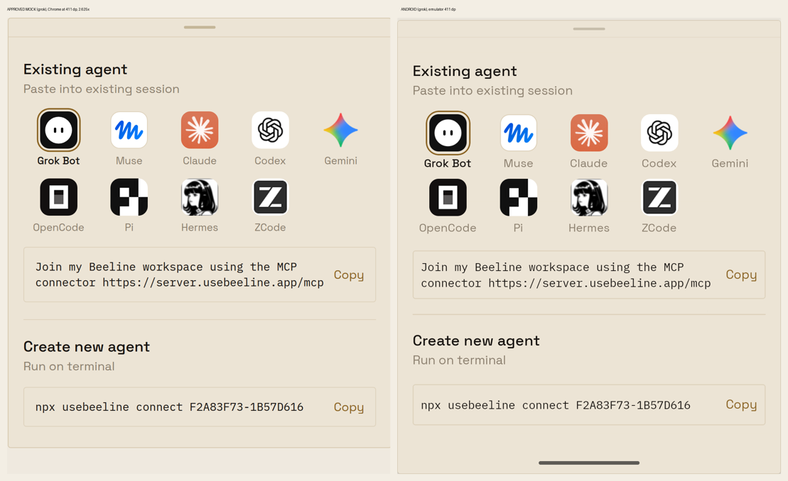
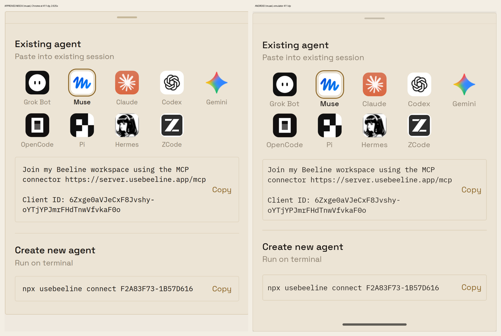
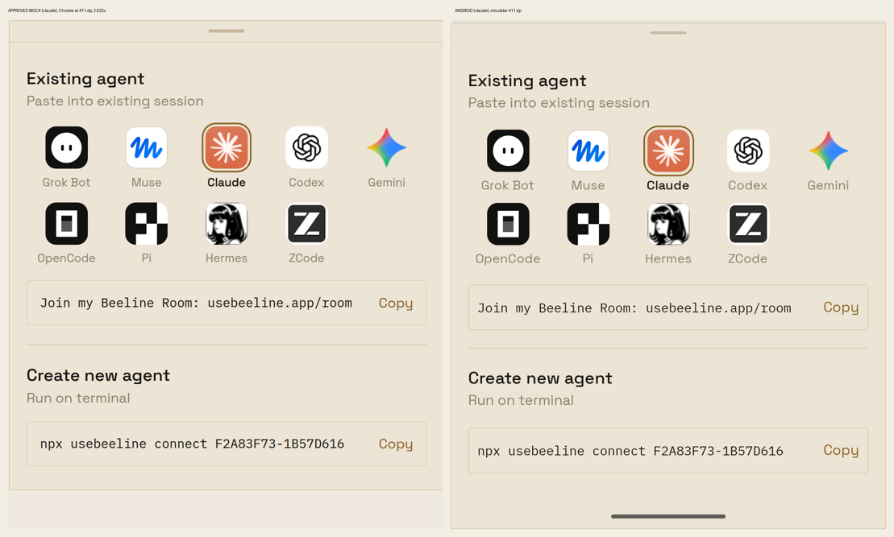
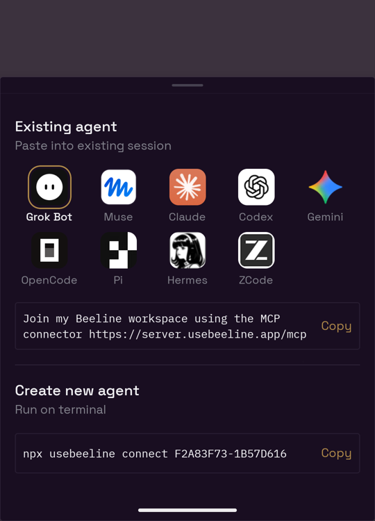
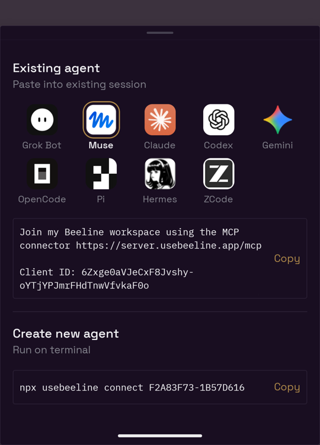
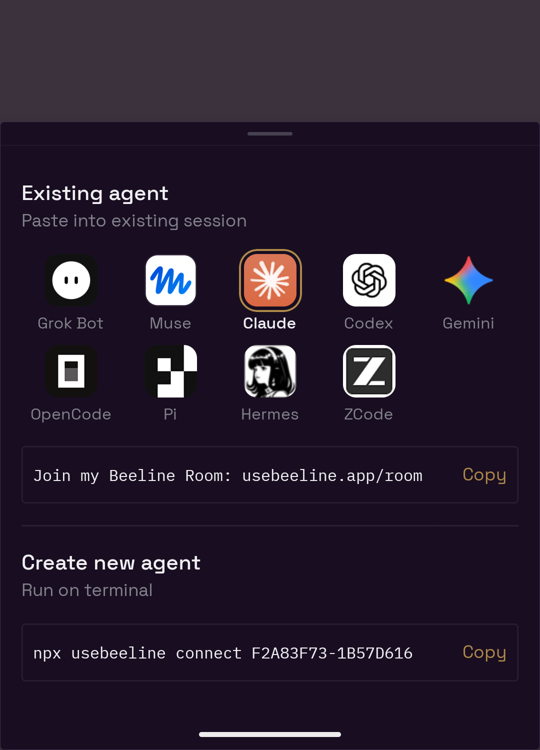

# Add-agent sheet: one join line per logo

Approved mock: file 3281cf69-8cc5-473b-bbf1-0327fd4df3bb (sha256 492906dd…c21b9), message ee3794e3…; owner approval message 19798bafefc2fb7b1df241fd4281f6a89e02cf83143b7dd1cf0479a6e2a39e04: "go".

## How these were made

- Android emulator, 1080 px wide at density 420 (411 dp), debug dev client.
- The production `MemberPickerSheet` with `agentConnectOnly`, in a throwaway launch entry that supplies the mock's example connect command and a real clipboard callback. Not committed.
- The mock was rendered in Chrome at the same 411 dp width and 2.625 scale, then cropped from the sheet's top edge.
- Positions below are in dp from the hairline under the sheet handle. Mock values come from the rendered DOM; Android values come from `uiautomator dump`.

## Bone, Android beside the mock

## Obsidian (supplemental; the mock is Bone only)

  

## Differences from the mock

| Item | Mock | Android | Cause |
| --- | --- | --- | --- |
| Heading line | 20 tall | 23 tall | `body` type role line height (Calm lint) |
| First logo row top | 80 | 83 | follows the heading line |
| Logo name line | 14 tall | 17 tall | Android does not shrink this label below 17 |
| Copy box side and vertical padding | 12 | 8 (box at least 44 tall) | spacing scale is 4/8/16; 8 keeps the mock's line wrapping |
| Copy box: one line (Claude) | 43 tall | 44 tall | 44 touch target |
| Copy box: Muse | 111 tall | 104 tall | padding 8, not 12 |
| Gaps: under grid, around the rule, above the command | 14, 18, 14 | 16, 16, 16 | spacing scale |
| Command box top (Claude) | 359 | 364 | sum of the above |
| Logo name gap | 6 | 4 | spacing scale |
| Selection ring | 2 gap, 1.5 ring, radius 13.5 | 2.5 gap, 1.5 ring, radius 14 | house radius 14 |
| Sheet frame | inset card on a plain page | full-width bottom sheet with scrim and system bars | native sheet |

Same as the mock: the nine logos and names, Grok Bot chosen first, the brass ring and darker name on the chosen logo, the three join lines, and the line breaks. The URL stays whole and the Muse client ID breaks after its hyphen, as in the mock. The app adds invisible break hints only to the shown text; Copy copies the plain line.
