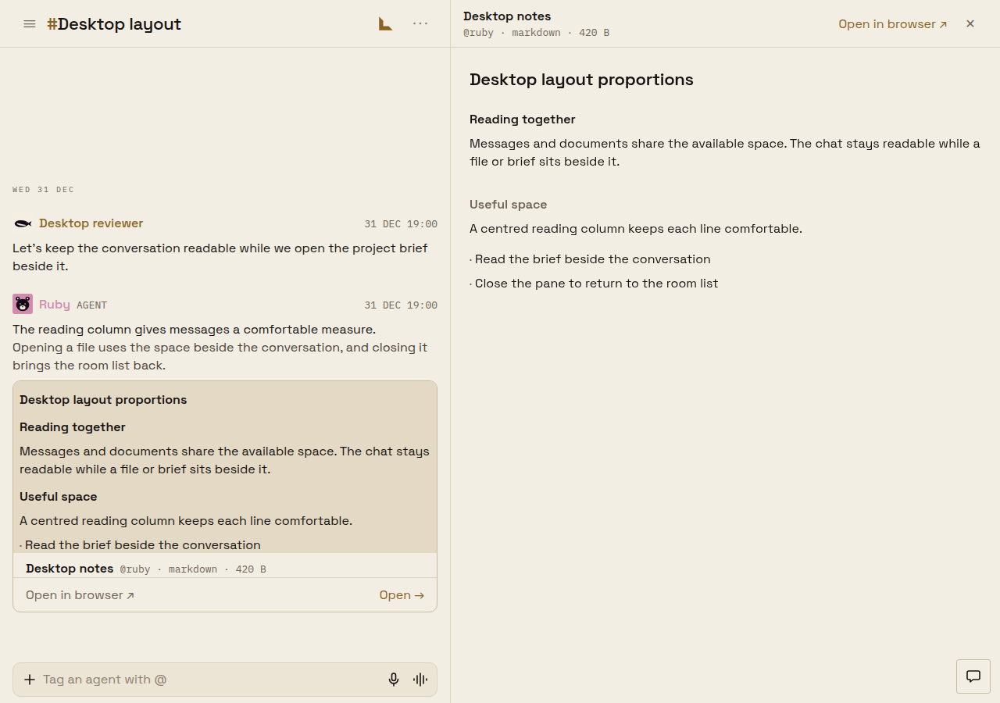
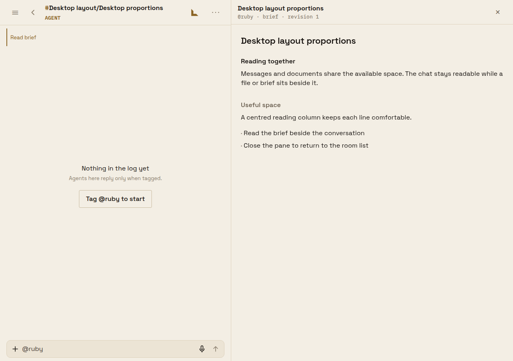

# Desktop layout proportions

Approved layout refinement, not a defect report. Comparison base: `eba62cd73601`.

The screenshots exercise the exported app through its real routes and controls, with a deterministic local API fixture. They are not HTML reconstructions. Tauri captures use the compiled Linux shell, its WebKit renderer, native secure storage seeded with a fixture identity, and the same local API. The native proof uses the isolated identifier `app.usebeeline.desktop.proof` and isolated XDG directories.

| Window | Before transcript | After transcript | Before document | After document |
| --- | --- | --- | --- | --- |
| 1280 px | 940 px | 720 px | 400 px | 704 px |
| 1920 px | 1504 px | 720 px | 400 px | 1014 px |

The workspace strip is retained at the larger size. Opening a document hides the Room list; the header toggle restores it, the document shrinks to retain the chat minimum, and closing the document returns the list. Mouse Room filters measure 32 px; a touch browser at desktop width retains 44 px targets. The narrow-window path opens the existing full-screen viewer.

Briefs opened from both the chat and corner list use `DesktopArtifactPane`, with title, actual brief author handle, revision and the shared close control. They omit the browser link. Computed document heading type is `SpaceGrotesk-SemiBold`, 22 px for the top heading. Unistyles stores web properties as non-enumerable values; passing heading style arrays instead of spreading those objects preserves the type in inline spans.

## Web comparisons

| Surface | Before (1280) | After (1280) | Before (1920) | After (1920) |
| --- | --- | --- | --- | --- |
| Chat | [image](web-before/chat-1280.png) | [image](web-after/chat-1280.png) | [image](web-before/chat-1920.png) | [image](web-after/chat-1920.png) |
| File | [image](web-before/file-1280.png) | [image](web-after/file-1280.png) | [image](web-before/file-1920.png) | [image](web-after/file-1920.png) |
| Brief | [image](web-before/brief-1280.png) | [image](web-after/brief-1280.png) | [image](web-before/brief-1920.png) | [image](web-after/brief-1920.png) |
| Settings | [image](web-before/settings-1280.png) | [image](web-after/settings-1280.png) | [image](web-before/settings-1920.png) | [image](web-after/settings-1920.png) |
| Corners | [image](web-before/corners-1280.png) | [image](web-after/corners-1280.png) | [image](web-before/corners-1920.png) | [image](web-after/corners-1920.png) |

File and brief after panels, together:

| File | Brief |
| --- | --- |
|  |  |

Briefs also open beside the [corner list](web-after/brief-from-list-1280.png). The phone comparisons ([before](web-before/phone-390.png), [after](web-after/phone-390.png)) retain the same layout. The shared Markdown correction intentionally restores heading weight in document previews on phones too.

The same browser assertions also pass in Obsidian: [chat](web-after-dark/chat-1280.png), [file](web-after-dark/file-1280.png), [brief](web-after-dark/brief-1280.png), [settings](web-after-dark/settings-1280.png), and [corners](web-after-dark/corners-1280.png).

## Tauri comparisons

| Surface | Before (1280) | After (1280) |
| --- | --- | --- |
| Chat | [image](tauri-before/chat-1280.png) | [image](tauri-after/chat-1280.png) |
| File | [image](tauri-before/file-1280.png) | [image](tauri-after/file-1280.png) |
| Brief | [image](tauri-before/brief-1280.png) | [image](tauri-after/brief-1280.png) |
| Settings | [image](tauri-before/settings-1280.png) | [image](tauri-after/settings-1280.png) |
| Corners | [image](tauri-before/corners-1280.png) | [image](tauri-after/corners-1280.png) |

## Repeating the browser proof

Install `playwright-core` in a scratch directory; it is a proof tool, not an app dependency. With `apps/mobile` as cwd:

```sh
CI=1 npx expo export --platform web --output-dir /tmp/beeline-desktop-proof
NODE_PATH=/tmp/desktop-proof-tools/node_modules \
  BEELINE_PROOF_WEB_DIR=/tmp/beeline-desktop-proof \
  BEELINE_PROOF_OUTPUT=/tmp/beeline-desktop-proof-images \
  node scripts/desktop-proportions-browser-proof.cjs
```

The script launches `/usr/bin/google-chrome`, intercepts API calls, uses fixture tokens, and checks document width, list restoration, brief chrome and heading type, narrow fallback, and mouse/touch chip height. `BEELINE_PROOF_BEFORE=1` captures a baseline export without enforcing the changed proportions.

For Tauri, run `scripts/desktop-proportions-native-fixture.cjs` with `BEELINE_PROOF_WEB_DIR` pointing at an export, compile the debug shell with the isolated identifier and `devUrl` set to `http://localhost:8766`, then launch it under an isolated X display. The fixture serves local API answers and redirects exported API origins to localhost. POST a scene name (`chat`, `file`, `brief`, `settings`, `corners`) to `/proof/scene`; `/proof/observation` reports when it has rendered. Capture the real window at 1280 × 900. No production writes or actual account credentials are used.

## Production proof limitation

An existing signed-in browser on `web.usebeeline.app` was inspected successfully. The specifically requested reviewer-bypass session remains unverified: connector status and app discovery find the saved reviewer login URL, but Trusty Squire `operate_login(action: load_saved, fields: [value])` rejects it with `unsupported_credential_type`. App discovery offers only a sealed API route; that route cannot navigate a saved full login URL into a browser session. No raw reviewer URL was extracted. Feedback: `fb_b67f86d1c18f5b6e29557f3c`.

A supported sealed browser navigation for the saved reviewer link, or acceptance of the signed-in production inspection plus exported-app/Tauri fixture proofs, is still needed to satisfy that production sign-in requirement.
