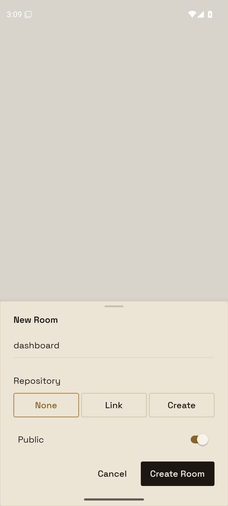
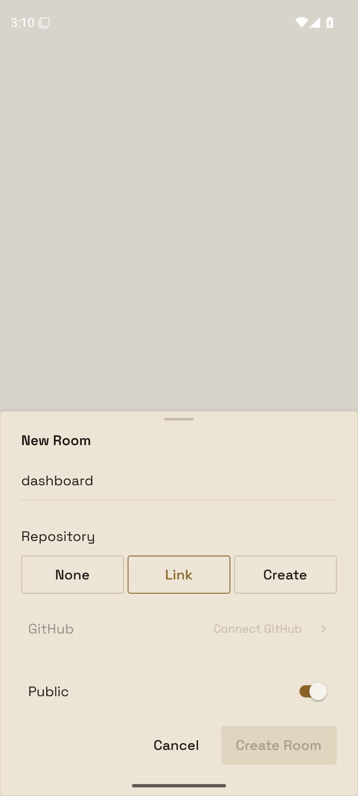
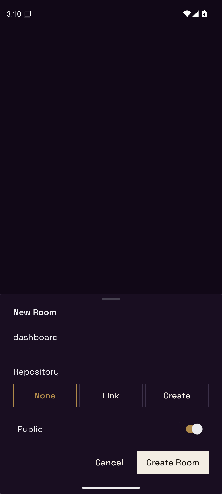
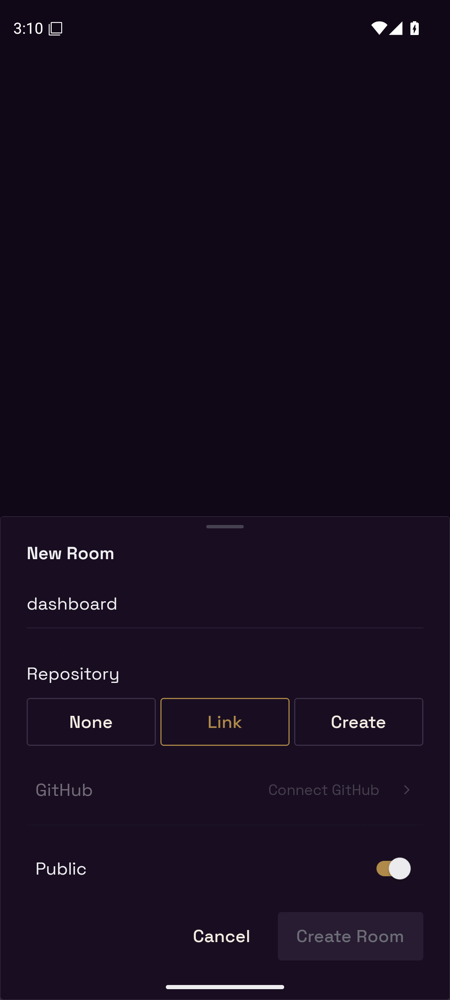

# Disabled primary / New Room proof

Reproduction disabled-primary-new-room: open New Room with name `dashboard`, expand Repository, and choose Link without a selected repository. Before this change, Create Room had a faded fill and contrasting ring, and the input rule plus Repository section border made two rules. Choose None to return to an enabled Create Room.

Captured on the leased Android API 36 emulator (1080×2400) using the baseline debug APK and Metro serving the changed source. Both themes now show one rule and a flat disabled action; choosing None preserves the enabled primary appearance.

| Theme | Enabled (None) | Disabled (Link without repository) |
| --- | --- | --- |
| Bone |  |  |
| Obsidian |  |  |

## Stand-in and replay

The fresh emulator has no signed-in production account. `Capture.tsx` mounts the real NewRoomDialog with production theme configuration, fonts, safe area and gesture provider; it replaces only the parent data/callbacks. No Room is created. This verifies the visual state transitions rather than authentication or a server write.

To replay, temporarily point `apps/mobile/index.ts` at `./evidence/disabled-primary-new-room/Capture`, serve Metro from `apps/mobile`, and open the debug app on the leased emulator. Tap Repository, then None for enabled or Link for disabled. Switch `setAppAppearance` between `light` and `dark`, reload, and repeat. Restore `index.ts` afterward; this capture is not an app route.

The approved before/after proposal is Beeline artifact `ef85905c-5126-4891-a278-43dde67fe063`. The screenshots in this directory are unmodified captures of the implemented result.
