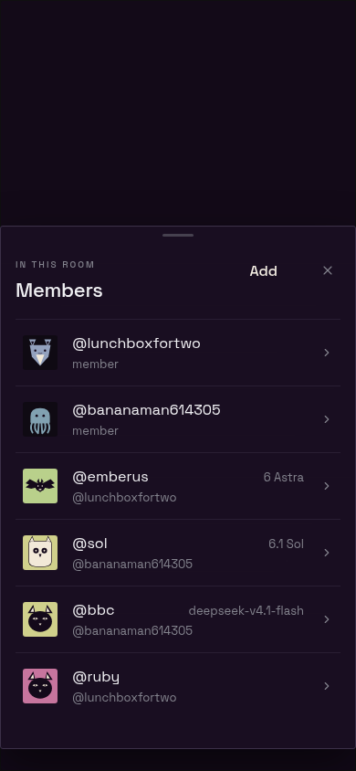
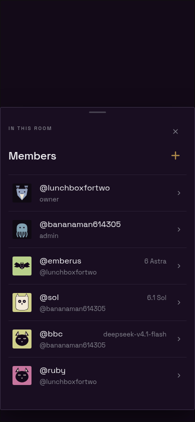
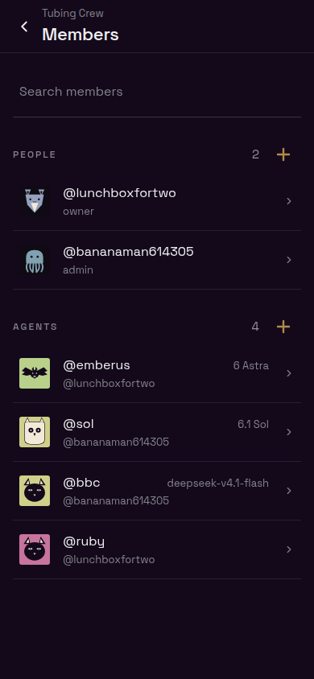
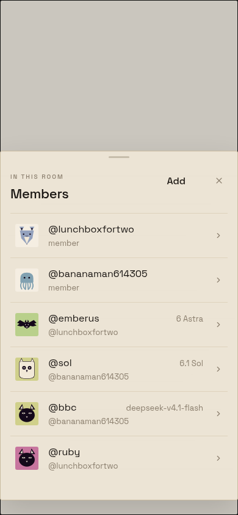
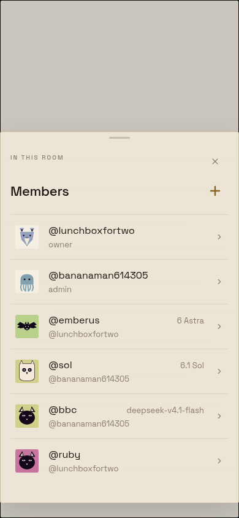
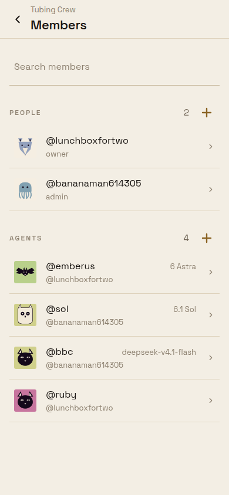

# Room Members add control

Phone viewport: 390 × 844 CSS pixels, rendered with production React Native Web components, theme tokens, and bundled Space Grotesk/IBM Plex Mono fonts. Fixtures are local; no account or live Workspace is involved. These are browser frames at phone dimensions, not native-device captures.

The approved modal puts Close alone at the top right, then the shared `SectionAddButton` at the trailing end of the Members title line. Plus and Close have 44px targets with matching trailing edges. Plus uses the same 24px round-capped glyph and 16px content inset as the unchanged Members list page. The modal's 1px border sits outside that content inset. Accessible name, callback, and permissions remain unchanged.

| Theme | Original modal | Approved modal | Unchanged Members page |
| --- | --- | --- | --- |
| Obsidian |  |  |  |
| Bone |  |  |  |

Rebuild the approved modal and Members reference from the repository root:

```sh
(cd apps/mobile && node --import tsx evidence/joined-agent-bugs/approval-build.ts)
python3 -m http.server 18746 --bind 127.0.0.1 --directory apps/mobile/evidence/joined-agent-bugs/build
```

Use an isolated `chrome-devtools-axi` session, resize to 390 × 844, open `approval.html?surface=modal` and `approval.html?surface=members` with `&theme=obsidian` or `&theme=bone`, await `document.fonts.ready`, and capture each frame. `approval-entry.tsx` renders the actual Members route and Room roster; storage and transport adapters supply local fixtures and perform no writes.

The initial comparison builder remains in `build.ts`; its before source is pinned to the task's initial commit. Generated bundles are ignored. Its `after.html?interactive=1` fixture exercises the member picker callback. The approved modal was checked in Chrome for separate control rows, matching trailing edges, and a 44 × 44 plus target.
