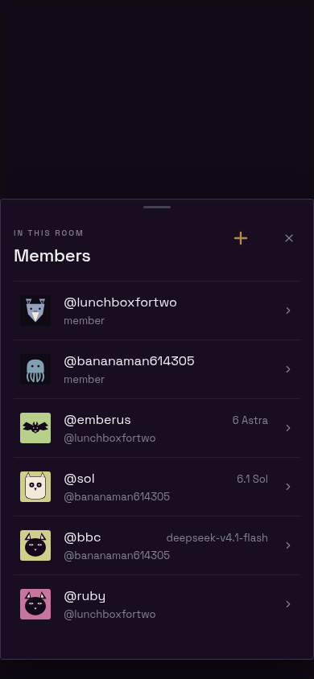
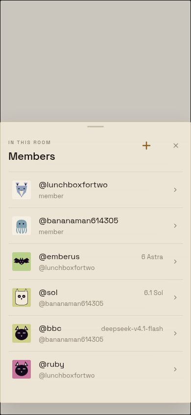

# Room Members add control

Phone viewport: 390 × 844 CSS pixels, rendered with the production React Native Web components, theme tokens, and bundled Space Grotesk/IBM Plex Mono fonts. Fixtures are local; no account or live Workspace is involved. These are browser frames at phone dimensions, not native-device captures.

The only visual change is replacing the text Add action with `SectionAddButton`, extracted from the Members list section header. Both surfaces now use its 24px round-capped plus and 44px touch target. Accessible name and callback remain Add members.

| Theme | Before | After |
| --- | --- | --- |
| Obsidian |  |  |
| Bone |  |  |

Rebuild from the repository root:

```sh
(cd apps/mobile && node --import tsx evidence/joined-agent-bugs/build.ts)
python3 -m http.server 18746 --bind 127.0.0.1 --directory apps/mobile/evidence/joined-agent-bugs/build
```

Use an isolated `chrome-devtools-axi` session, resize to 390 × 844, open `before.html` and `after.html` with `?theme=obsidian` or `?theme=bone`, await `document.fonts.ready`, and capture each frame. The before source is pinned in `build.ts` to the task's initial commit. Generated bundles are ignored. Add `&interactive=1` to either URL to use the local roster/picker fixture and exercise the add callback. The captured after control was also checked in Chrome for a 44 × 44 target and successful picker opening.
