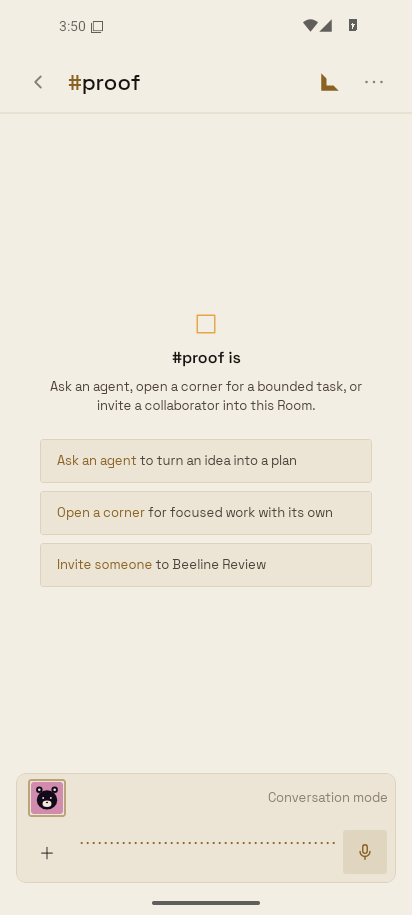

# Android native crash recovery

Validated on 2026-10-13 with a task-owned API 36 x86_64 AVD on
`emulator-5588`, a locally signed `assembleRelease` APK with Hermes, and an
isolated PGLite server and LiveKit instance. Speech providers were no-op
fixtures. No production Workspace, helper, or shared emulator was used.

The release build connects through the actual composer long press and
publishes a microphone track to LiveKit. A first-run microphone permission
prompt, Bluetooth enabled, and a background/resume cycle did not produce a
fatal voice startup crash. A wired route was attempted through Android's audio
service and emulator switch events, but the emulator audio HAL rejected the
device; this is **not** a proof of wired/Bluetooth headset routing on Samsung.

Two real process deaths were forced through Android/ADB, with no crash trigger
added to shipped code:

1. `am crash app.usebeeline` raises
   `RemoteServiceException.CrashedByAdbException` on Android's main thread.
   The provider-installed handler persisted the exception and stack and then
   delegated to Android's original fatal handler. After relaunch, the existing
   authenticated client-error endpoint received the receipt.
2. `kill -6 <app pid>` raises `SIGABRT`, bypassing JVM exception handlers.
   On relaunch, `ApplicationExitInfo` supplied a native tombstone. The module
   decoded the signal and crashing thread's backtrace and sent them to the same
   endpoint. Memory, registers, command line and log buffers are not reported.

Both reports included the crashed device, OS/API level, app version, release
SHA, runtime and OTA identity. The receipt disappeared from the app's private
`no_backup` directory only after the endpoint accepted it. Sanitized endpoint
records are in [reports.json](reports.json); raw device/SDK logs and local
credentials remain in ignored scratch files.

The final release APK also retained a third `SIGABRT` receipt while the local
server route was unavailable. Restoring the route and resuming the app sent
that receipt once and removed it after acceptance.

Unit coverage includes tombstone decoding/corruption/bounds, HTTP rejection,
offline retention, sign-in/foreground retries, sign-in during an in-flight
unauthenticated attempt, duplicate callbacks, and old binaries without the
native module. Android 12+ provides native signal backtraces when retained by
the OS; fatal JVM exceptions are captured on all supported Android versions.
If Android does not retain a trace, the receipt explicitly says so.

The Samsung v0.1.50 root cause has **not** been identified. The read-only Play
Reporting workflow returned `403 SERVICE_DISABLED`, rather than an empty set
of crash reports. Its temporary workflow was removed. The account owner must
enable the Reporting API before crash clusters can be retrieved. No speculative
voice transport fix is included.

This addition requires a **store build** and server deployment. Android runtime
advances 34 → 35. Expo also fingerprints the new local module descriptor on
iOS, so the existing gate requires iOS runtime 33 → 34; no iOS crash recorder
is introduced. Both previous pins remain in OTA compatibility coverage. The
optional native-module lookup keeps the JS update safe on older binaries,
which cannot acquire the new native recorder through OTA alone.
