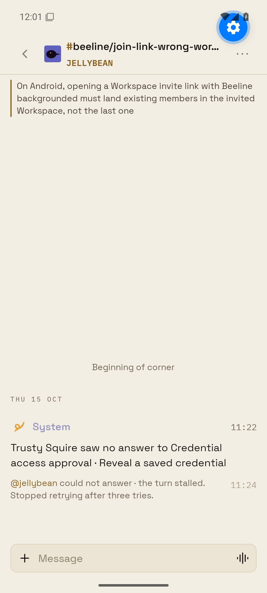
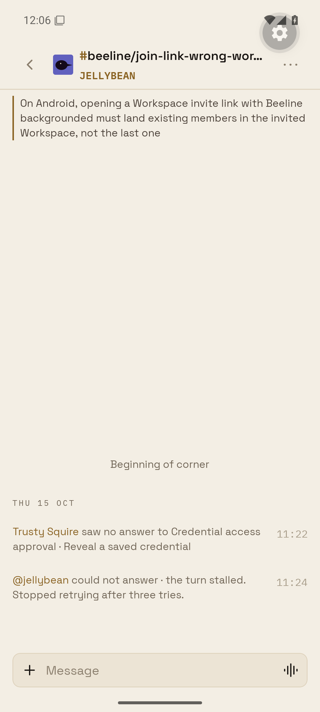

# NOTICE-STYLE-1 Android stand-in

The owner supplied the real-corner before screenshot. An authenticated real-corner after check needs the owner's account and will be checked on the next release the owner commands. No release is dispatched by this proof.

The authorized stand-in uses the full shipped Android chat route in Expo Go against a local server. The server migrates an isolated in-memory PGlite database, seeds a corner named join-link-wrong-workspace, and serves the real PhoneService.readRoom response at http://10.0.2.2:8893/room. Authentication, persistence, routing and unavailable native integrations use the existing offline-proof adapters. Theme values, the chat screen, transcript selection, ordinary renderer, System identity mark and LedgerSystemLine remain production code.

The two rows in notice-style-proof/rows.json were copied by a read-only production query. Their ids, author ids/kinds, text, presentation, card_type, payloads, system_event and timestamps are preserved. The server asserts that their stored types and payloads remain unchanged. The fixture introduces a separate local Reader identity; it does not sign in as the owner or write to production.

Before uses the main renderer at b3d3bdc6e65398d290f8ce3d277a5efa113a16b4. After uses the PR renderer. That renderer is the only production module changed by this PR; the same full chat route and same local database are used in both bundles. No types or presentation values are rewritten by the harness.

## Run

From the repository root, after npm run corner:prepare:

```
npm install --prefix apps/mobile/notice-style-proof --legacy-peer-deps
node --import tsx scripts/prove-notice-style-server.mts
git show 'b3d3bdc6e65398d290f8ce3d277a5efa113a16b4:apps/mobile/sources/app/(app)/beeline/chat/RoomMessageVariants.tsx' > apps/mobile/notice-style-proof/baseline.tsx
```

In another terminal:

```
beeline emulator -avd se_api35 -no-window -gpu swiftshader_indirect
cd apps/mobile/notice-style-proof
NOTICE_PROOF_BUILD=main CI=1 ../node_modules/.bin/expo start --go --port 8197
```

Install Expo Go SDK 55 on the leased emulator, reverse tcp:8197, set its timezone to America/New_York, and open exp://127.0.0.1:8197. Capture the two rows. Restart Metro with NOTICE_PROOF_BUILD=pr and reload the app against the same server to capture after. The before module is a generated, ignored copy of the pinned main source; no baseline behavior is simulated.

## Diagnosis

The 11:22 row has presentation card, card_type squire-approval-decision and a present payload (tool fetch_credential, title Credential access approval, detail Reveal a saved credential, status expired, plus approval/agent identifiers). PhoneService's switch only projects squire-approval into the squireApproval field. The decision type returns the base DTO. It therefore skips SquireApprovalCard; presentation card also leaves isSystemNotice unset. The phone reaches OrdinaryLedgerMessage, which previously drew the System member header and avatar. The fix changes only that fallback for the fixed System author. Working card/approval components and server storage/projection are unchanged.

## Result

On Android API 35, the main bundle shows the 11:22 System header/logo and large body; the PR bundle shows the exact same notice as LedgerSystemLine. Both original timestamps remain visible. The 11:24 line retains its exact text and native bounds in both UI trees. The local server returned the same card/system types for both bundles.

| Main before | PR after |
| --- | --- |
|  |  |

[Real-corner before supplied by the owner](owner-before.jpg). The Android UI hierarchies are saved alongside the screenshots.
