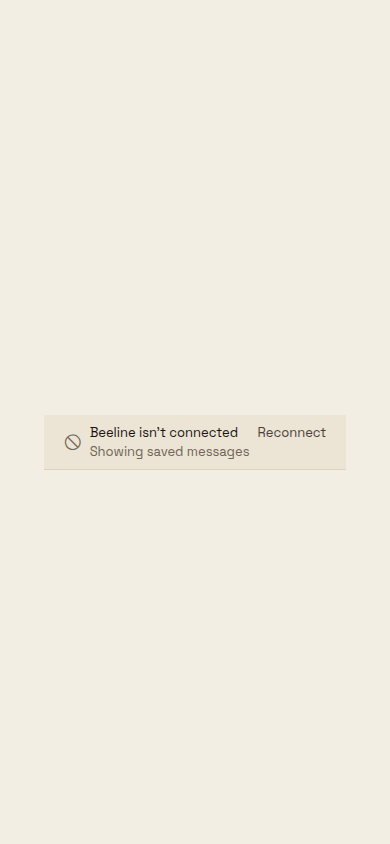
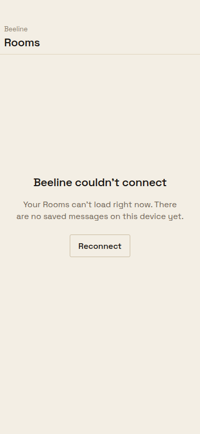
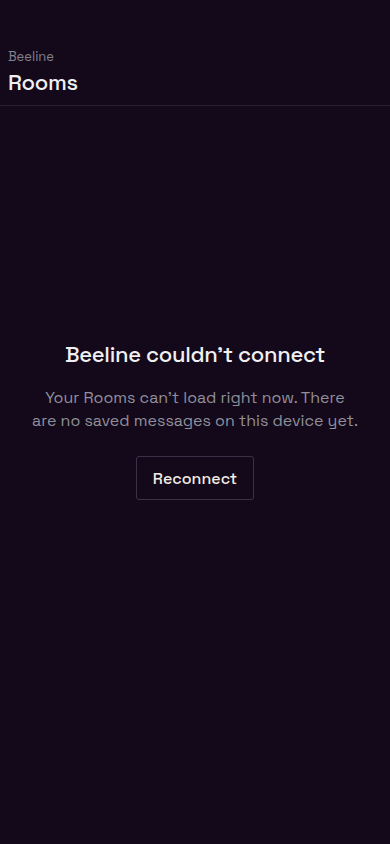

# Uncached Room-deck recovery

Approved treatment A applies when the initial Room-deck read fails because of the connection and there is no saved list to display. `RoomDeckUnavailableView` uses the shared page header, a centered explanation and one secondary Reconnect Button. Its action reconnects the socket and retries the failed bootstrap read. The existing in-app `ConnectionStatus` component is unchanged; saved Rooms continue to render with that banner. Server refusals retain their existing error row.

These screenshots render the production React Native components through React Native Web at 390 × 844, in Bone and Obsidian. The before frame reproduces the original centered `ConnectionStatus` branch. Socket state and the action are inert proof adapters; these are component captures, not Android device captures.

| Theme | Before | After |
| --- | --- | --- |
| Bone |  |  |
| Obsidian |  |  |

Build the frames from the repository root:

```sh
apps/mobile/node_modules/.bin/tsx apps/mobile/scripts/build-room-deck-unavailable-proof.mts .beeline-proof/room-deck-unavailable
```

Serve that directory locally, then use `chrome-devtools-axi` at 390 × 844 to open `bone.html` / `obsidian.html`, and add `?before` for the prior state. Wait for `document.fonts.ready` before capture. Both themes were checked for horizontal overflow and one Reconnect callback per click.

Regression coverage: `sources/app/(app)/beeline/channels.live.test.tsx` exercises persistent startup timeouts, recovery while the socket is already connected, reconnect plus re-read, server refusals and preservation of saved content with the in-app banner. `ConnectionStatus.test.tsx` and `deck-landing.test.ts` retain the banner and landing contracts.
