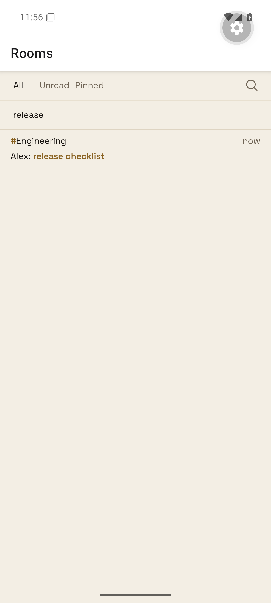
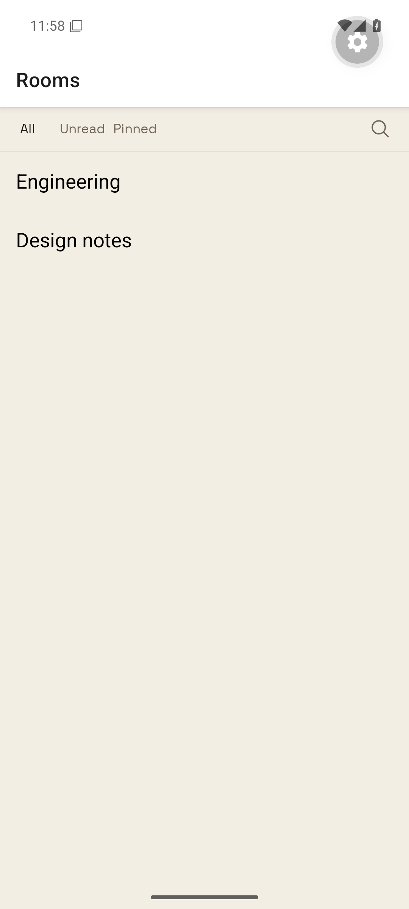
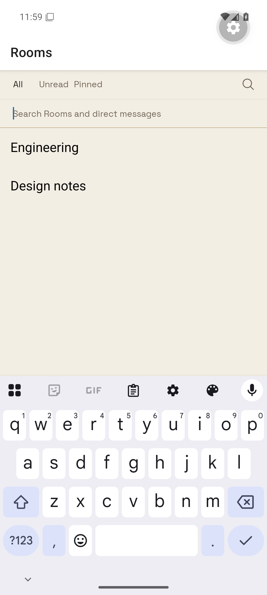

# Search return — SEARCH-RETURN-1

The owner asked: “when I return backwards from a search, the search bar should be cleared and retracted, instead of search results continuing to show”. Brief revision 2 records the reproduction; original human approval is message `c293c482a1f9f7668ec0fec34f1eac71f7d1e987b38f140527dffa883f49b43f`. There was no visual mock; this changes navigation state without redesigning controls.

## Reproduced

SEARCH-RETURN-1: on the leased Android API 36 emulator (`emulator-5554`), open search, type `release`, open Alex's message result, and press Android Back. The original query/toolbar state leaves `release`, the expanded bar, and the old message result on screen ([baseline-back.png](baseline-back.png), [baseline-back.xml](baseline-back.xml)). [baseline-result.png](baseline-result.png) shows that the result screen was opened first.

This is a native Expo Go SDK 55 stand-in, not a production account or a complete installed Beeline app. The isolated emulator had neither Beeline nor a signed-in session. `search-return-proof` renders the production `RoomListToolbar`, `MessageSearchResults`, `useMessageSearch`, fonts, and tokens inside a real React Navigation native stack. The baseline copies only the original `useTextDraft` query and toolbar open state. A fixture search read supplies one message; the detail screen and unfiltered list rows are fixtures. Expo Go adapters replace Unistyles, reduced motion, and the unused keyboard controller; the explicit fixture identity bypasses identity lookup. No production traffic or account writes occur.

The desktop rendered regression fails against the original `SidebarView` because the search field remains mounted after navigation back ([baseline-regression.txt](baseline-regression.txt)). Removing the phone focus reset also makes its regression fail with `release` instead of an empty query ([phone-regression-without-reset.txt](phone-regression-without-reset.txt)).

## Demonstrated

Repeat SEARCH-RETURN-1 with the production `useRoomSearch` state owner: Android Back returns to the full list, search is retracted, and message results are absent. Reopening search shows an empty field. [fixed-result.png](fixed-result.png) shows the opened result; [fixed-back.xml](fixed-back.xml) has both normal list rows and neither search input nor results; [fixed-reopened.xml](fixed-reopened.xml) shows the empty field's placeholder. [android-assertions.txt](android-assertions.txt) records those assertions.

| Before Android Back | After Android Back |
| --- | --- |
|  |  |



The focused suite passes all 76 tests ([regression-after.txt](regression-after.txt)), covering phone focus reset, rendered desktop navigation, old draft cleanup while preserving room-name/composer drafts, asynchronous message search, result rendering, and existing text-draft behavior. Root `npm run typecheck`, mobile typecheck after the final edit, `npm run lint:ui-components`, and `git diff --check` pass. The text-draft integration suite and both design lint suites also pass (25 tests).

## Repeat

Prepare root/mobile dependencies and workspace builds. Install Expo Go SDK 55 on a Beeline-leased emulator. From `apps/mobile/search-return-proof` run:

```
EXPO_OFFLINE=1 REACT_NATIVE_PACKAGER_HOSTNAME=127.0.0.1 ../node_modules/.bin/expo start --go --lan --port 8201 --max-workers 2
```

From the repository root, reverse the port and open the fixture:

```
adb -s emulator-5554 reverse tcp:8201 tcp:8201
adb -s emulator-5554 shell am start -a android.intent.action.VIEW -d exp://127.0.0.1:8201 host.exp.exponent
python3 apps/mobile/search-return-proof/device.py tap 'Search conversations'
adb -s emulator-5554 shell input text release
python3 apps/mobile/search-return-proof/device.py tap message-search-result-fixture-message
python3 apps/mobile/search-return-proof/device.py snap result
adb -s emulator-5554 shell input keyevent 4
python3 apps/mobile/search-return-proof/device.py snap back
```

Wait for the Rooms screen and dismiss Expo Go's initial Continue sheet before tapping. Select a different leased device by changing the script's adb serial. Set `baseline=true` in `search-mode.js` and reload to repeat the wrong result; restore `false` to repeat the fix. The proof output goes under `.beeline-proof/search-return`. Run only one UIAutomator operation at a time.
