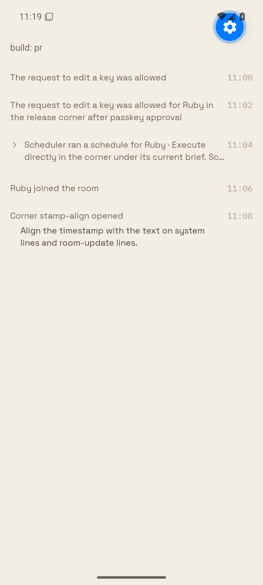

# STAMP-ALIGN-1 Android proof

Reproduction STAMP-ALIGN-1: on Android, a system line or room-update line draws its time stamp lower than the first line of its text. The owner's screenshot showed "The request to edit a key was allowed" above its "11:00" stamp.

Real-target account proof needs the owner's session. The stand-in renders the production `LedgerSystemLine` and `LedgerRoomUpdate` from `sources/components/buzz/Ledger.tsx` in Expo Go SDK 55 on the `se_api35` emulator (1080x2400, density 2.625), with the shipped fonts and bone theme.

Rows: a one-line system line, a two-line system line, a clamped system line with the disclosure chevron, a one-line room update, and a room update with a digest.

## Run

1. Copy `apps/mobile/notice-style-proof` (without `index.js`, `rows.json`, `node_modules`) to `apps/mobile/stamp-align-proof`, delete the `NOTICE_PROOF_BUILD` resolver branch in its `metro.config.js`, and copy `proof-index.js` there as `index.js`.
2. `npm install --prefix apps/mobile/stamp-align-proof --legacy-peer-deps`
3. `beeline emulator -avd se_api35 -no-window -gpu swiftshader_indirect`
4. In `apps/mobile/stamp-align-proof`: `EXPO_PUBLIC_STAMP_BUILD=<main|pr> CI=1 ../node_modules/.bin/expo start --go --port 8198 --android --clear`

Before uses `roomUpdateStamp.top: 7` (main 5d6aec653). After uses this PR's `top: theme.buzz.space.xs`. Nothing else differs.

## Result (Android UI tree, px)

| Row | Text top | Stamp top, main | Stamp top, PR |
| --- | --- | --- | --- |
| system, 1 line | 293 | 300 | 292 |
| system, 2 lines | 406 | 413 | 405 |
| system, clamped | 569 | 576 | 568 |
| room update | 747 | 755 | 747 |
| room update + digest | 860 | 868 | 860 |

Main draws each stamp 7-8 px (3 dp) low. The PR stamp shares the first text line's 50 px line box (1 px rounding). The screenshots show matching baselines, so no extra font offset is needed.

| Main before | PR after |
| --- | --- |
|  |  |
