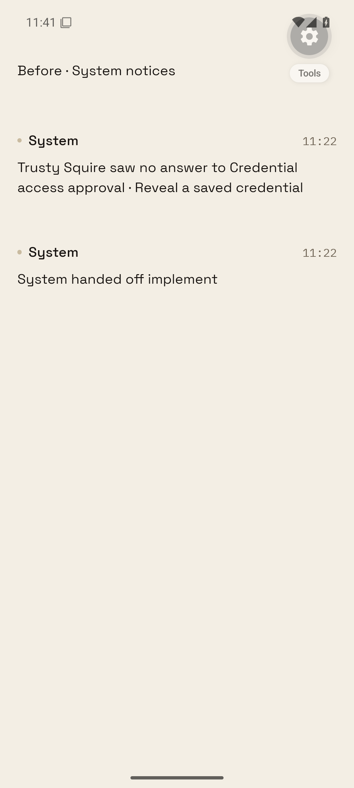
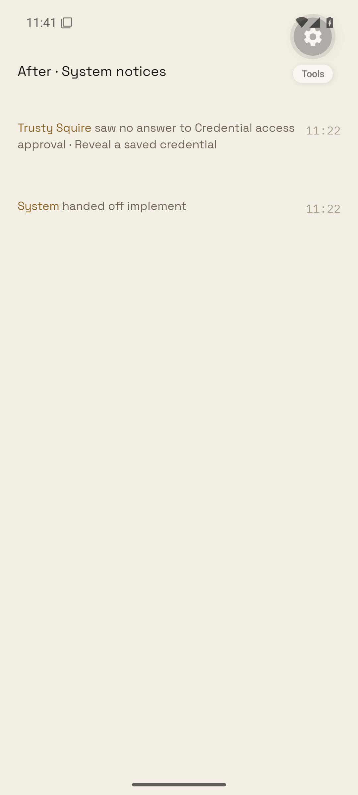
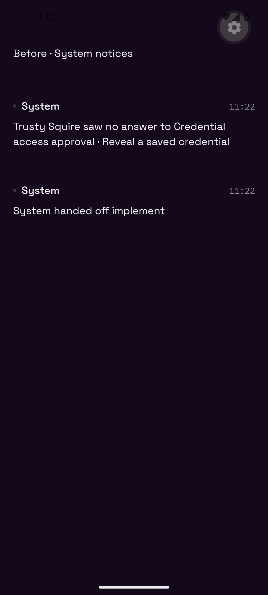
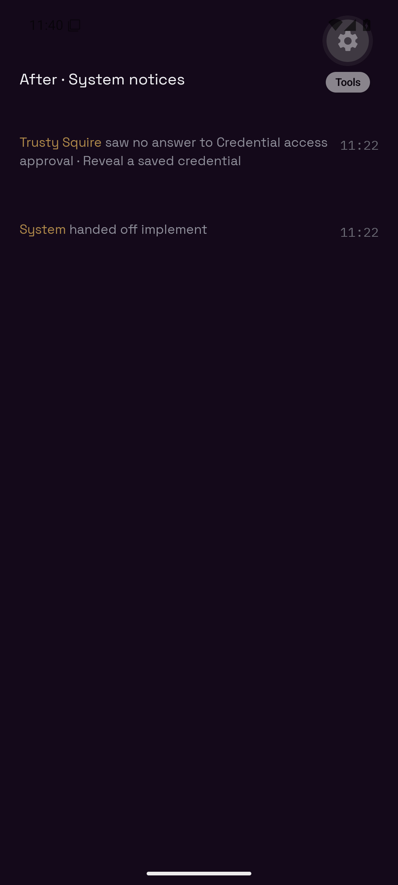

# System notices: Reproduction R1

Open a transcript containing a historical Squire approval decision or handoff notice. Before: a System byline and full body text. After: the existing small LedgerSystemLine, without the System byline. Interactive cards keep their controls.

The owner's attached Android screenshot establishes the production defect. The local Android proof uses Expo Go on API 35 and shipped LedgerEntry/LedgerSystemLine plus displayRoomMessage. It uses JSON produced by the real PhoneService.readRoom against an isolated PGlite database containing legacy notice cards. Expo Go adapters replace Unistyles and animation plumbing; the before byline uses LedgerEntry's plain-dot fallback because Expo Go's SVG ABI differs. The notice text, styles and small-line component are shipped code. It does not sign into production or post messages. This is a native component/service stand-in for the authenticated full app.

Run from the repository root:

```
node --import tsx scripts/prove-system-notice-lines.mts
cd apps/mobile/notice-proof
CI=1 ../node_modules/.bin/expo start --go --port 8197
```

Open exp://127.0.0.1:8197 on the Android emulator with adb reverse tcp:8197 tcp:8197. Tap the heading to switch Before/After. Set proof-theme.ts to bone or obsidian and reload for each theme.

## Captures

| Theme | Before | After |
| --- | --- | --- |
| Bone |  |  |
| Obsidian |  |  |

[Owner production screenshot](owner-before.jpg)

## Producer inventory

The shared rule is an allowlist of implemented interactive surfaces, applied at systemLine writes and PhoneService projection of historical system cards. Unknown notice types become small automatically. Card metadata remains stored for wake routing and history. Ordinary human/agent card messages are outside the rule.

| Producer | Non-interactive card metadata |
| --- | --- |
| daemon-service.ts, squireApprovalDecision | squire-approval-decision |
| workbench.ts, connection receipt | connection-receipt |
| wallet.ts, signing delegation and typed-data audit | wallet-delegation, wallet-signature |
| Legacy wallet records supported by PhoneService | wallet-tx, wallet-insufficient |
| workflow-runs.ts | workflow-handoff, including handed-off notices (new writes already system) |
| corner-lifecycle.ts | corner-workflow-handoff (bookkeeping remains hidden) |
| github-operations.ts | github-corner-note (new writes already system) |
| connector-offer-completion.ts | connector-offer-decision (remains hidden) |
| grant-policy-upgrade.ts, phone-service.ts | grant-decision (remains hidden) |
| membership-join.ts | member-joined (already system) |
| phone-service.ts | member-left, member-removed, room-visibility, agent-yolo (already system) |
| turn-silence-notice.ts | turn-failed (already system) |
| room-choice.ts | choice settlement kinds (already system) |

Preserved surfaces: permission, grant-request, squire-approval, computer-session, connector-offer, app-sign-in, agent-sign-in, choice, target-branch, github-event, daemon-fact, corner, corner-app, voice-call. These provide approval/answer/dispatch controls, navigation, playback or expandable PR/check records. Wallet receipt components expose no controls and therefore become system lines.

No additional notices, release, or live database rewrite is needed.
