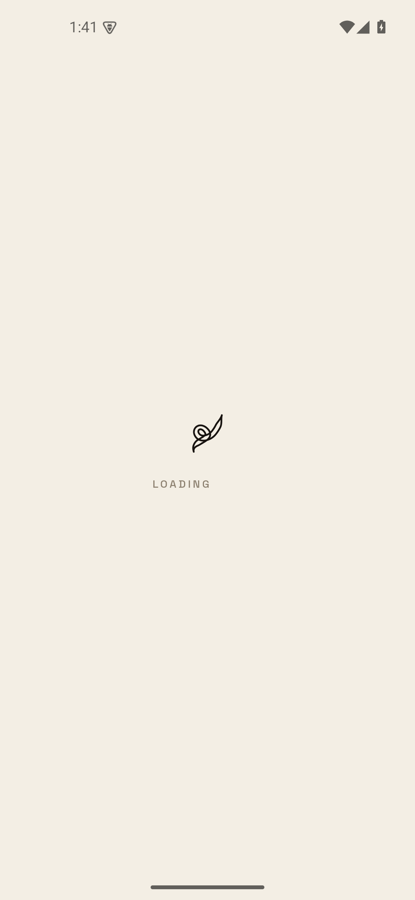

# A visible cold-start landing

The root layout releases the native splash when fonts settle. At that point,
`app/(app)/index.tsx` used to return `null` both while its local identity/initial
URL/onboarding reads were pending and after requesting its destination, before
that navigation committed. A slow read or a dropped first navigation dispatch
therefore left the focused route with only the system status/navigation bars.

The focused landing now renders the existing `RoomDeckLoadingView` in both
states. Storage errors and the existing stalled-navigation recovery keep their
own visible screens. A landing mounted underneath a deep-linked destination
continues to render nothing, so it does not run a hidden animated loader.
No storage, navigation, retry, deadline or native/runtime behavior changed.

## Release-like Android reproduction

An isolated, owned Android 35 x86_64 emulator (`emulator-5640`, SwiftShader) ran
the original Play 144/runtime 44 universal APK. Only the local cached launch
asset was replaced by production/Hermes exports from source `c5cd26ce2` plus this
change. The saved sign-in and selected Workspace belonged to the production
Beeline Review fixture (`bee11e00-0000-4000-8000-000000000105`); no owner Workspace
was opened and no messages were sent.

Both diagnostic bundles held **only the landing's identity-read promise**
pending. This is a controlled reproduction of the empty render state, not a
claim that the original 2-of-5 production report had that particular slow read.
After JavaScript started and the native splash was released, the control's
native UI hierarchy had no app text or loader. The candidate's hierarchy had
`rooms-loader-gate`, `rooms-loader`, `rooms-loader-glyph` and `LOADING ROOMS`.
The screenshots were taken after that handoff, with the read still pending:

| Before | After |
| --- | --- |
|  |  |

The bundles' SHA-256 values are:

- Control with held read: `654f725a3ab53af468cc7c9a468be24b441516c5fa0c114276eb60f1af92a9d9`
- Candidate with the same held read: `15fbe4074db264dbf639a44649fbe76eb26b1acfce06219746ce1f0f6da7b51f`
- Clean candidate, with the diagnostic hold removed: `d80d0a2c054f7e2b396f41de499195edc3d5133d78cc6dbf9bbf55d7e3d80787`

A separate cold start of the clean candidate reached the selected Beeline Review
Workspace and displayed the proof Room row in the native UI hierarchy.

No hold, timestamp, test route or tracing switch is present in product source.
No OTA or native binary was published. This fix addresses the blank waiting
state; it does not claim the separate 450 ms Room-list paint target is met.

## Validation

The two new held-read regressions failed against the original route because
it rendered no loader. The full adjacent `index.test.tsx` suite passes after
the fix (14 tests), including pending identity, pending initial URL, navigation
handoff, hidden landing, storage error, onboarding, invite/review links and
notification/back routing. Run from `apps/mobile`:

```sh
./node_modules/.bin/vitest run 'sources/app/(app)/index.test.tsx' --maxWorkers=2
```

Root `npm run typecheck` and `git diff --check` also pass. Native captures use
`screenrecord --bugreport`, logcat and UI-automator text/identifiers; no JS frame
callback is treated as proof of rendered content.
