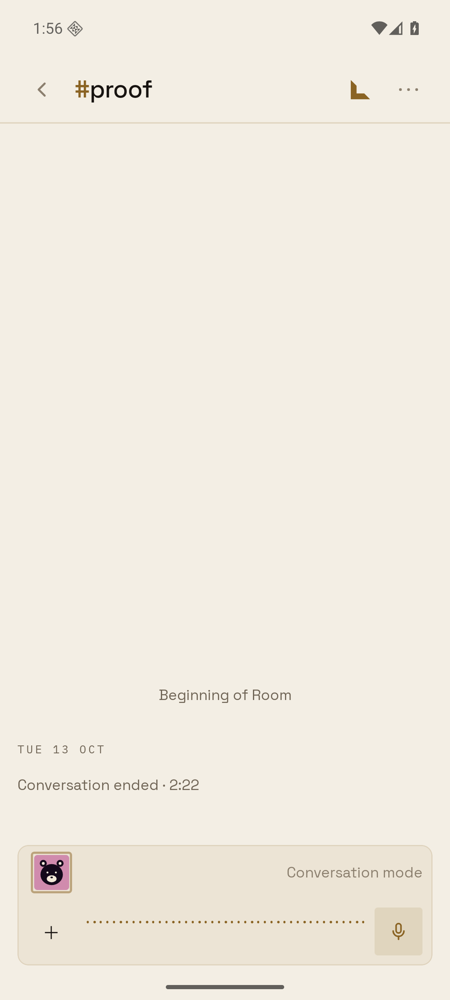
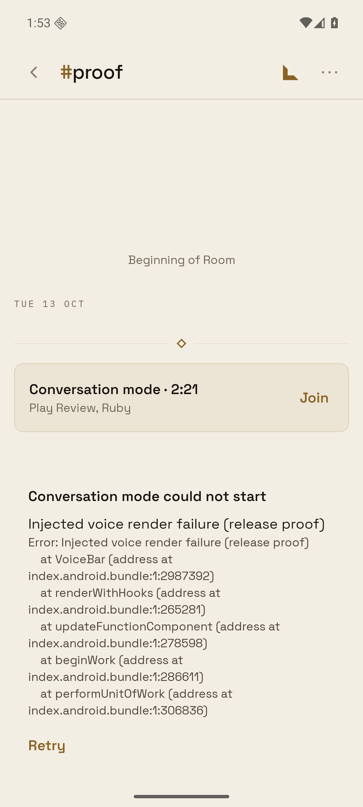

# Android Conversation mode error recovery

Captured on 2026-10-13 using a task-owned API 36 x86_64 AVD on emulator-5580,
local `assembleRelease`, release Hermes JS, and an isolated in-memory server
with a disposable human and agent. LiveKit signalling, RTC and microphone
publication were real; speech providers were no-op fixtures. No production
Workspace or helper was used.

The local v0.1.49 tag build matched its committed native fingerprint:
Android runtime 34, `99b729f12334602f0ac9264b5eba640b2b1fd425`.
It connected, rendered inline and full-screen controls, and showed readable
errors for unavailable voice service and denied microphone permission.
The reported original blank screen did **not** reproduce. This patch is
containment and diagnostics, not a claim that the device-specific cause is known.

A clean `npm ci` of the final branch also passes the native fingerprint gate
with the unchanged Android and iOS stamps. The patch uses the same native
dependencies and runtime. Its release build
renders Conversation mode in the composer and connects to LiveKit:

A separate release proof variant inserted
`throw new Error('Injected voice render failure (release proof)')`
at the beginning of `VoiceBar`. That injection exists only in the ignored
proof build tree, never in production source. Pressing the actual mic with
a long press preserved the Room header and transcript and showed the error,
stack top and Retry:

The isolated server received `[client-error]` with scope `conversation`, the
injected error text, the `VoiceBar` frame, Android version 36, runtime 34,
and the running update ID and release SHA. Raw device logs are intentionally
not committed because SDK logs may contain local proof JWTs.

Regression tests cover render failure and Retry, root recovery without app
providers, reporting failure, WebRTC object rejections, native Room-constructor
cleanup, and preserving the original join failure when cleanup also fails.
The cleanup regression fails against the original `use-voice-call.ts`.

Mobile changes are JS-only and OTA-compatible. Server deployment is required
for the new authenticated `/v1/phone/observations/client-error` log endpoint;
the UI and Retry remain functional if reporting is offline or the endpoint is
not yet deployed. React boundaries cannot catch fatal native-thread crashes.
