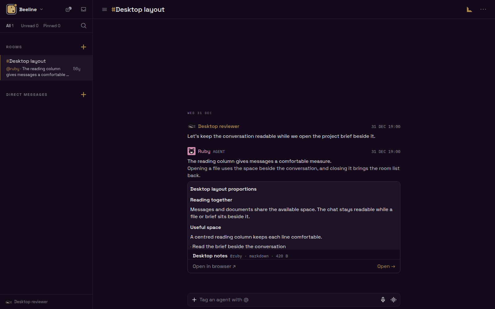
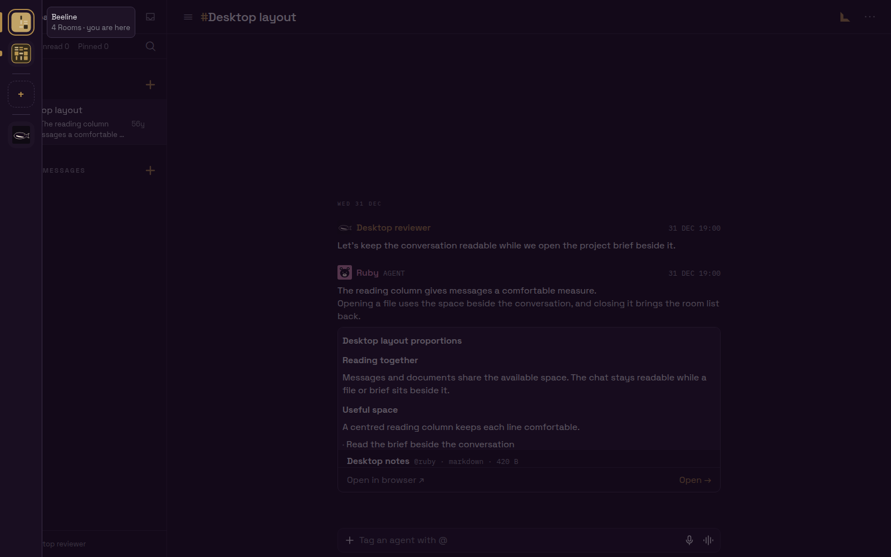
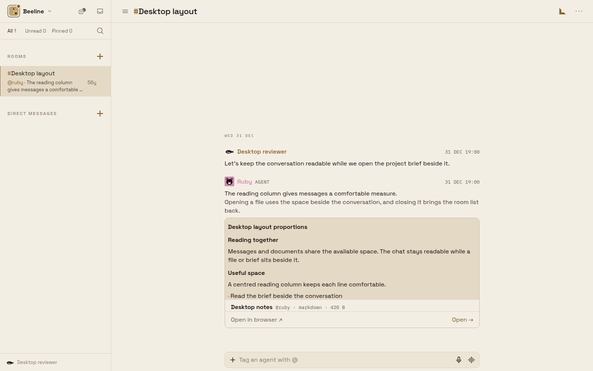
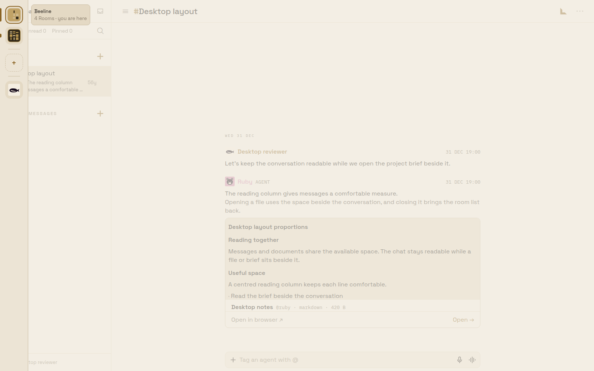

# Desktop workspace rail

Feature request, not a defect report. The approved mock asks for the existing
workspace overlay at every desktop width, with attention visible while closed.

The screenshots use the production Expo web export and deterministic API
fixtures in Chrome at 1600 × 1000. They exercise the real SidebarView,
CommunitySwitcherTrigger, DesktopWorkspaceRail, portal, and Unistyles CSS variables.
No production account or server writes are involved.

```sh
cd apps/mobile
CI=1 npx expo export --platform web --output-dir /tmp/jellybean-rail-web
BEELINE_PROOF_WEB_DIR=/tmp/jellybean-rail-web \
BEELINE_PROOF_RAIL=1 BEELINE_PROOF_DARK=1 \
BEELINE_PROOF_OUTPUT=../../.verification/workspace-rail/obsidian \
node scripts/desktop-proportions-browser-proof.cjs
```

Run again with `BEELINE_PROOF_DARK=0` and a Bone output directory. The script
requires `playwright-core` and `/usr/bin/google-chrome`.

Both themes pass: no permanent strip, navigation at x=0, attention dot and
Settings row visible, avatar opens the overlay, Escape closes it,
Ctrl+Shift+S opens it, and clicking the scrim closes it. The screenshots show
the active tile's metadata on one line. Recorded computed scrim colors have
alpha 0.66 in both themes; see the measurement JSON files.

| Theme | Closed | Open |
| --- | --- | --- |
| Obsidian |  |  |
| Bone |  |  |
