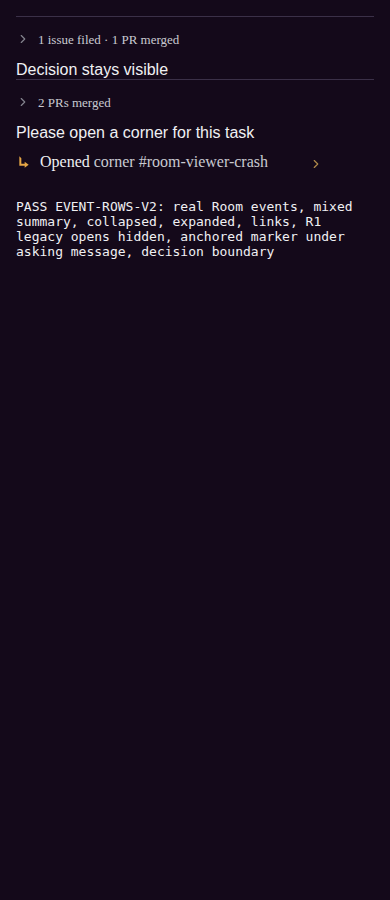
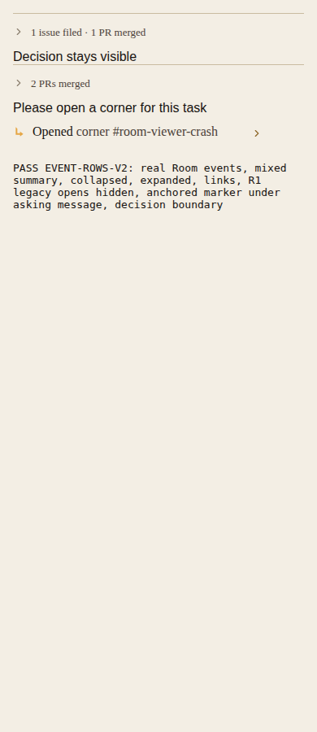

# Corner opens only at call sites — R1

The service proof uses an isolated PGlite database and the real DaemonService.createCorner → PhoneService.readRoom path. A private command opens a corner; no production corner is created by this proof.

On the original daemon-service.ts, the R1 regression fails because the Room transcript gains an unanchored corner-open row. On this branch the same regression passes: Room message ids stay unchanged, no corner-open card is written, and the Room's legacy opened-event subscriber receives its command. A message in a parent corner produces exactly one marker in that transcript with its sourceMessageId, and no parent Room marker.

Corner-watch tests also prove opened watches wake once from the existing corner start record and modern Room subscription actions still fire. The phone's existing human-created anchored path passes the HTTP integration proof; silent agent opening produces no push.

The browser proof bundles the actual client projection functions and notification/marker components, using saved Room notification fixtures and a synthetic asking message. It verifies old unanchored rows are absent, the anchored marker is beneath the asking message, its link opens the correct corner, and PR links and grouping still work. It covers phone and desktop widths, Obsidian and Bone, and both reduced-motion settings. These are component-level browser stand-ins, not screenshots of signed-in production #beeline.

Production browser proof remains pending. Squire opened web.usebeeline.app into a non-reviewer welcome session. Vault metadata confirmed the reviewer bypass exists, but sealed browser-fill returned unsupported_credential_type. A sealed HTTP fetch returned the web shell and did not authenticate a browser. The local environment has no BEELINE_REVIEW_SECRET and browser-use is not installed. The live Squire browser was shared in this corner for owner sign-in; no other identity was used.

After reviewer sign-in and deployment of the fixed client, capture #beeline in both themes with a resident anchored marker and no generic opening rows. Production is still running released code, so it cannot prove this branch's fixed rendering yet.

Validation:

- Root npm run typecheck.
- Server corner-open-from-corner, corner-open-implementer, corner-watch, system-line, system-line.contract and system-messages-lock suites.
- Targeted HTTP integration cases: silent agent open, inherited public Room corner access, human anchored marker and rename.
- Mobile corner-markers, pr-accordion, ci-accordion and pr-accordion.browser suites.
