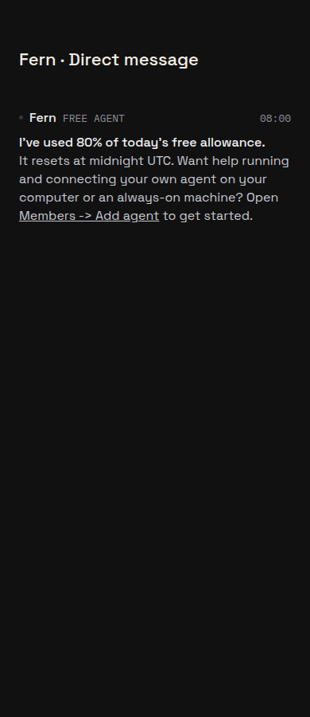

# Free-agent warning and connection guide

Feature proof FREE-GUIDE-1; not a defect report.

The built server's model HTTP endpoint was exercised on localhost with an isolated
PGlite database and synthetic upstream. At 80% settled usage, the owner's
`PhoneService.readRoom` showed the warning, another member's read returned no
Room, a repeated request created no duplicate, and only the requested model call
reached the upstream. Regression coverage lives in `free-agent-model-proxy.test.ts`
and `free-agent-warning.test.ts`.

This screenshot is a local web component build, using the app's real `LedgerEntry`
and markdown renderer with the warning text emitted by that built-server proof.
The existing `runBrowserProof` harness supplies native adapters and isolated
headless Chrome. Assertions passed for warning text, UTC reset and Members link.
It is a renderer stand-in, not a screenshot of a deployed server or the full Expo app.

On production, the existing owner's browser session reached Workspace menu →
Members at `/beeline/members?communityId=18e555f7-e191-452b-9b0f-b825f58ee4ba` and
showed the Add agents control. No pairing code was generated. The specifically
requested reviewer-bypass sign-in remains unverified. Its credential is vaulted;
a secure browser handoff for it has not been established. The owner session is a
partial stand-in pending a decision on reviewer login/proof.

Server coverage: all 167 test files exercised in memory-bounded batches; 2,674
tests passed and seven existing tests skipped. Both message-producer snapshots were
updated for the approved private warning, and their 18 tests passed on rerun.
Repository typecheck and server build passed. The 239-case integration file was
split into eight name-filtered batches whose passing counts sum to all 239 cases.
