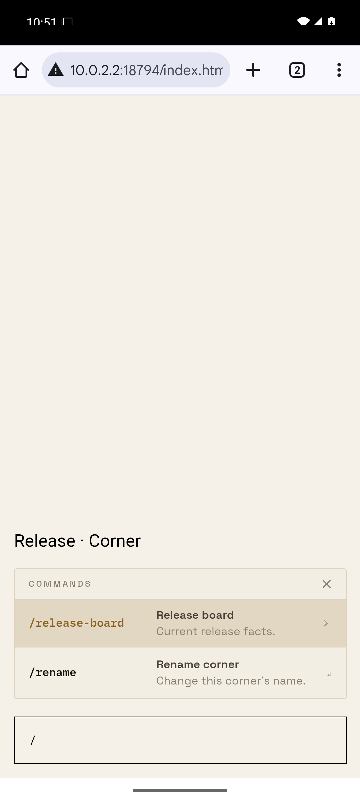
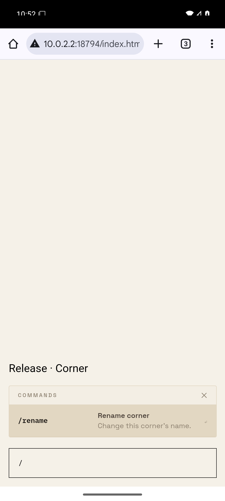

# Removed Corner Apps

Feature retirement, not a defect report. Brief revision 1 was approved by lunchboxfortwo: “@ruby yes get rid of it” (message c24ca338b827384dceae12642bed7fbb26a64f05bd5e087cdb614cab3241c2a6).

Reproduction RETIRE-APPS-1: render the shipped slash picker with an installed `/release-board` command and a built-in `/rename` command. Before removal, both rows appear. After removal, only `/rename` appears. The surviving command selection and corner-opening paths are covered by the picker, corner list, live corner/channel and transport tests.

The screenshots use the built React Native Web component in Android Chrome on the corner's emulator, Bone theme, with bundled app fonts. This isolated component proof supplies the old app data directly; it is a stand-in for an authenticated native corner, not a production screenshot. The before component comes from the parent commit. The after component comes from this change. Device status and browser chrome are outside the app surface.

| Before | After |
| --- | --- |
|  |  |

The retired app screen, card and installation picker were removed. The surviving slash rows use the existing shared `ContentTarget` to satisfy the UI policy after their selection offsets changed; their text, spacing and colors stay the same. No mock was requested; the words above authorize the removal.

Storage proof: `database.test.ts` creates populated legacy tables with the installation/binding foreign key, runs the production migration twice, and verifies that all three tables are absent. `retired-tools.test.ts` and `minimal-tool-surface.test.ts` reject reintroduction into agent discovery or external AI exclusions.
