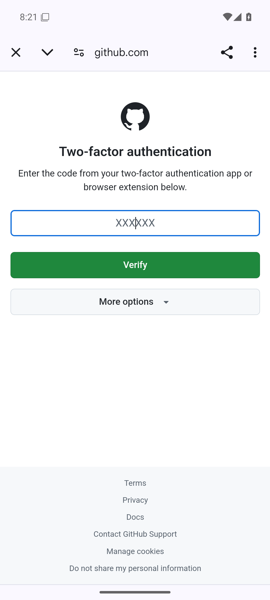
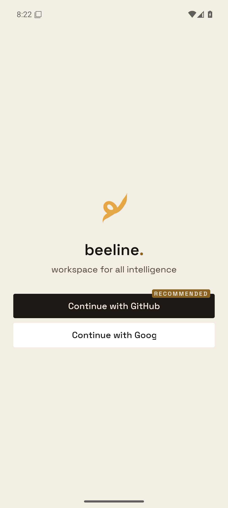
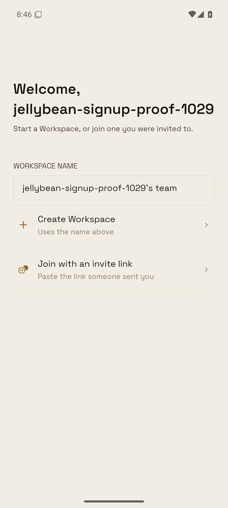
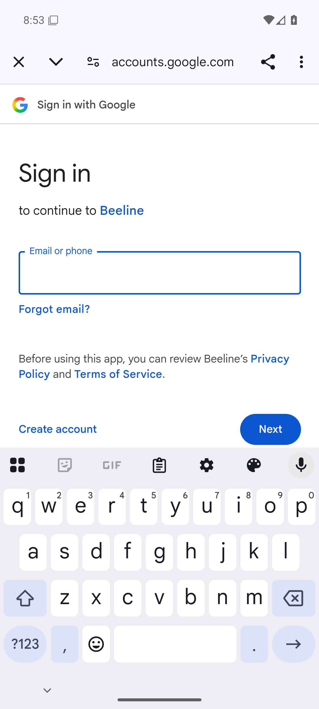

# Reproduction signin-appswitch

An Android API 36 emulator ran the Play-signed universal APKs downloaded directly
from Play Console. Browser storage initially had no GitHub or Google session.
Production OTA updates remained enabled. The native version is not the funnel's
JavaScript version: native build 144 is 0.2.24, while its attempts sent 0.2.22.

## Before

Each forced-switch attempt reached the real provider form, pressed Home, opened
Aegis for at least 21 seconds, and returned through Recents or a tap on the actual
Beeline home-screen icon. No credentials were entered in this matrix.

| Native build | Provider | Return | Server attempt | Result during observation |
| --- | --- | --- | --- | --- |
| 127 / 0.2.22 | GitHub | Launcher icon | `50492326-eb6c-4ac8-8dbb-18bee43d683a` | App remained pending; `started` only. |
| 127 / 0.2.22 | GitHub | Recents | `114d4e68-18f9-41d5-aa3a-3520c8819987` | Chrome tab absent from Recents; selecting Beeline left the app pending. |
| 144 / 0.2.24 | GitHub | Launcher icon | `ef4b1126-dfad-42f9-8685-7353e1701a27` | **Cancelled**; buttons freed, no provider callback. |
| 144 / 0.2.24 | GitHub | Recents | `ef5081a9-5b58-4662-a38b-ce86d6426b43` | Chrome tab absent; selecting the remaining Beeline task **cancelled** sign-in. |
| 144 / 0.2.24 | Google | Launcher icon | `1a44f581-b612-4d20-930a-2ac2378fe425` | Identifier tab restored; `started` only. |
| 144 / 0.2.24 | Google | Recents | `5b342946-f8fb-4581-bfbb-b821ccdbbfe5` | Identifier tab restored; `started` only. |

Build 127 did not send funnel context on these starts, so its server `version`
and `platform` fields are null. Its APK's embedded version is 0.2.22; no transmitted
version is inferred. Build 144 sent Android / 0.2.22 on every recorded start.
Google's native account-add prompt was dismissed before entering the browser
fallback; the native flow's separate cancellation is not a browser-switch failure.
Likewise, cancellations caused by clearing a previous attempt for the next run
are outside that previous run's observation window.

The accepted failing launcher run started at 00:58:53.204 UTC and was cancelled
at 00:59:30.760 UTC on November 3, before its return screenshot at 00:59:36 UTC.
The Recents failure was cancelled at 01:01:50.388 UTC, before its return screenshot
at 01:01:56 UTC. See [server stages](server-build144-before.json).

### Full GitHub TOTP supporting reproduction

Only the owned `Jellybean signup proof 1029` test account was used. TOTP was enabled,
the seed was vaulted separately from its existing password, and recovery codes
were vaulted. Aegis held the same seed. The account reached GitHub's real TOTP
challenge, then Home → Aegis (21 seconds, code read) → the Beeline launcher icon
lost the tab and freed the app's sign-in buttons.

Attempt `96889099-0644-4738-bc16-71b36e100c52` started at 01:19:14.494 UTC and
was cancelled at 01:22:31.408 UTC. There was no provider callback or ticket exchange.
The authorization was still within the server's five-minute flow lifetime.

The Google test credential did not identify an existing account. No replacement
account was created. Its proof is the real identifier-page app switch authorized
by the commander, not a completed Google login.

## After: fixed release APK

The APK and embedded bundle hashes are in `fixed-build.json`. The locally built
release reports 0.2.22 (native build 27). Its server attempts omit version/platform;
those null values are preserved in the server evidence rather than inferred.

| Provider | Return | Attempt | Result |
| --- | --- | --- | --- |
| GitHub, real TOTP | Launcher icon | `757cd8cd-b50d-4305-85f9-58814effb5e3` | Tab restored after Aegis; provider returned, ticket issued/exchanged; app showed the signed-in welcome screen. |
| GitHub, real TOTP | Recents | `3133dbbc-4377-4de2-baee-90d239a7dac8` | Tab restored after Aegis; provider returned, ticket issued/exchanged; app reached notification permission after sign-in. |
| Google, identifier page | Launcher icon then Recents | `de33ce62-f6ae-472a-b2e6-76f7374b7d7a` | Each Aegis visit lasted 21 seconds; identifier tab restored on both returns; server remained started during observation. |

The earlier Google native account-add attempt `2587eeb9-a484-4cfc-a4c8-0b5b54294c76`
was deliberately dismissed to reach the browser fallback. Its cancellation
precedes both forced-switch runs. Google proof remains the commander-approved
identifier-page stand-in; a complete Google account login was not performed.

See `server-fixed-github.json`, `server-fixed-google.json`, and the matching
`fixed-*` UI snapshots/logcat. The regression run against original session code
failed all six new session cases; the restored implementation passes all 127
auth/onboarding tests. Root typecheck, workflow paths, architecture, and phone
network checks pass. Full mobile suite and iOS device proof were not run: this
change is Android-specific, with existing shared and non-Android session tests
included. Ruby owns the first outside Android success check after shipping.

## Implementation

Android dismissal no longer revokes a pending sign-in. Its state-bound deep-link
listener and server recovery remain available, with a five-minute bound matching
the server's default OAuth flow lifetime (`apps/auth/src/server-context.ts`). A new
press aborts the previous attempt and revokes only that attempt's recovery token.
GitHub also uses the same Android task restoration options already used by Google,
so the authenticator return can restore its tab above Beeline. Web and iOS retain
their existing browser-close handling.

The new session regressions failed against the original implementation for both
`cancel` and `dismiss`. The replacement regressions also failed against the
original session modules. They verify that a late link can complete and that a
replacement retains its own state and token. The existing onboarding tests cover
retryable buttons and callback-route ownership.
