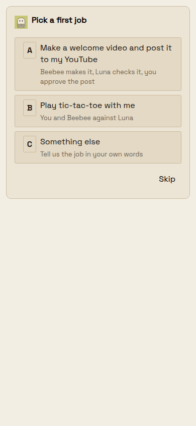
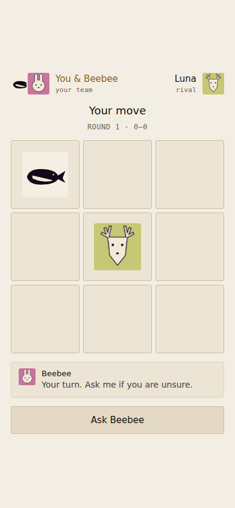

# Welcome jobs

Feature delivery under corner brief revision 1; not a defect report.

Run `npm run build -w @beeline/server` followed by
`node --import tsx scripts/prove-welcome-jobs.mjs`.
The built PhoneService creates isolated Workspaces, displays the welcome card,
selects A/B/C, and exercises the saved workflow runtime and stored game.
PGlite and in-memory storage replace production PostgreSQL and Tigris.
No production user is enrolled, and no provider signup, film generation or
YouTube upload happens in this proof. State handoff contents are fixtures.

WELCOME-JOBS demonstrates:

- Exact labels and subtitles; Workspace creation seeds a definition without starting a run.
- A starts one run, refuses a repeated tap, and dispatches the sleeping hosted Beebee.
- The checker is Luna; assigning Beebee to check his own film is refused. A blocked checker exhausts safely into the recovery gate.
- B posts Luna's playable stored game with inline identity faces and no video workflow.
- C starts no workflow; Beebee receives the ordinary job-choice wake, with the repository guide retained for coding requests.
- A missing existing-Workspace definition is backfilled idempotently without starting a run.
- A fallback maker's upload is refused before Post, rejects changed metadata, and accepts the exact preview once. A later non-video choice cannot remove this guard.

The contract was adapted from the owner's latest production `free-credits-film`
revision (6), read through the read-only database route. Owner-specific signup
identities were removed, portrait dimensions made explicit, and creation ends
when the existing Post/Cancel preview is ready. The workflow's completion is
never upload approval. Upload still goes through `consumeStarterVideoPost`.
The shipped game template is byte-for-byte the template in commit `6158e1e6a`.
The server container allowlist includes it. Existing viewer open/close funnel
measurement remains active; game posting records the stored artifact id and Room.

For surface proof, install Playwright outside the checkout and run
`PLAYWRIGHT_CORE_PATH=/path/to/playwright/index.mjs node scripts/render-welcome-jobs.mjs`.
This paints the real mobile ChoicePlate with the built service's DTO, within a
fixture card frame, using the app fonts and Bone tokens. It renders and taps
at phone and wide sizes and plays a move against Luna in the stored HTML.
This is a browser stand-in, not a signed-in Android production session.

Impeccable critique: a first-time user can see all three jobs and their
consequences without scrolling on the phone; Skip remains available. Labels
wrap without truncation. The initial harness lacked the actual font faces and
agent portrait; both were corrected together before the final capture.
The game clearly names both teams and responds visibly to a player move.
Both layouts have no horizontal overflow; no game changes were needed.

A read-only Fly inspection found the assigned Beebee Machine replacing and
Luna stopped, both with an image digest rather than a version label. This does
not prove Squire is ready on either Machine. The image update remains Ruby's
separate work; workflow steps declare timeouts and explicitly instruct blocked
handoff when Squire is unavailable.
