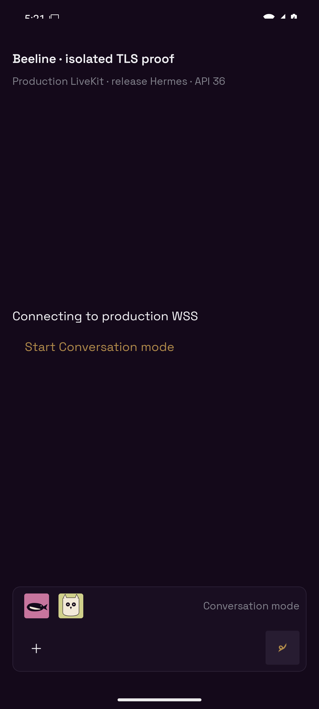
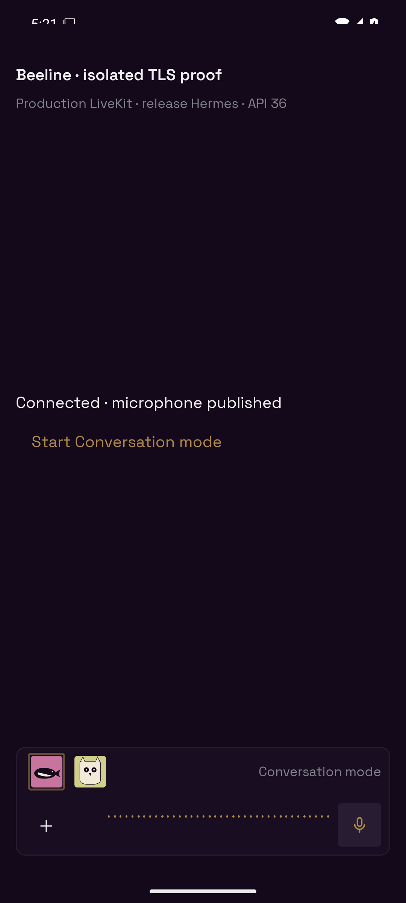
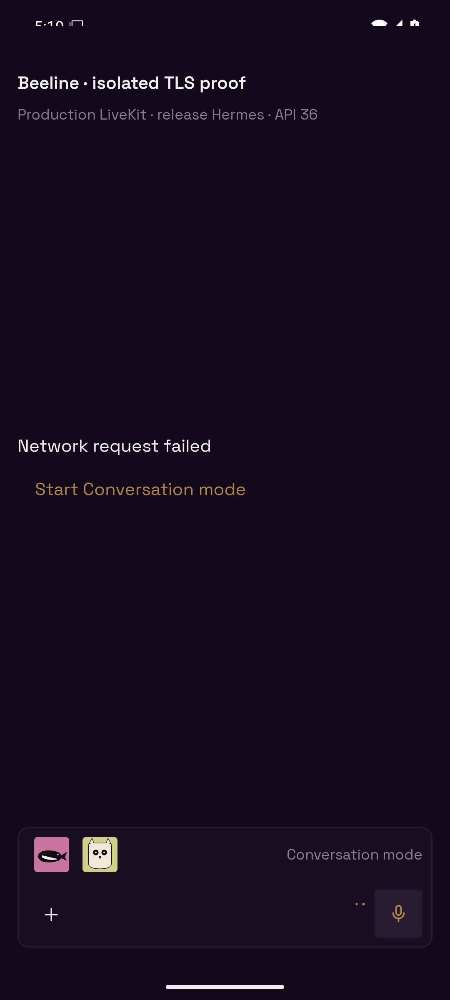

# Android production WSS proof

Captured 2026-10-13 on the task-owned API 36 x86_64 AVD `emulator-5592`.
The APK was built with `assembleRelease`, Hermes bytecode and a non-debuggable
manifest. Android runtime remains 35; iOS remains 33.

The error was reproduced verbatim in the existing server release image:

```text
engine: signal failure: transport connection error: IO error: no native root CA certificates found (errors: [])
```

That image had no OS CA bundle. Installing `ca-certificates` made the same
native Rust connection reach production LiveKit's HTTP 401 for an invalid JWT.
The complete fixed `apps/server/Dockerfile` image passed
`scripts/prove-voice-tls.mjs`. Overriding its native CA paths with an empty file
and directory reproduced the original error again, proving this is an OS trust
store dependency rather than an Android certificate or LiveKit server problem.

For the device proof, short-lived JWTs were minted for two participants in a
unique `beeline-tls-proof-*` LiveKit test room. No existing Beeline Workspace,
installed helper, provider or real agent was used. The proof bundle supplied
an isolated join response with those scoped credentials and an eight-second
delay, then ran the actual `useVoiceCall`, native `createVoiceRoom`,
`ConversationComposer`, `VoiceBar` and `IdentityMark` source. Authentication
and the Room roster were fixtures; TLS, signaling, ICE, microphone capture and
audio publication were real against `wss://beeline-voice-livekit.fly.dev`.

The fixed server-image peer connected through Rust, published a tone, subscribed
to the Android microphone, and received **101 actual audio frames**.
[The result](result.json) records the APK checksum, Hermes bytecode header,
server image identity and media assertions. This proves transport and microphone
publication, not provider speech generation or physical Samsung speaker output.

The Room agents are present before join credentials arrive:



They remain present after production WSS connects and the microphone publishes:



A separate failed local credential request retained the avatars and the end mic:



Regression tests in `use-voice-call.test.tsx` and
`ConversationComposer.test.tsx` cover the pending request, failed join, exit,
the authoritative joined roster, early target selection and rejection of a
target omitted by the server. The pending, roster and error regressions fail
against the original code.
The Docker build also refuses a missing or empty CA bundle.

Raw SDK/device logs, scoped JWTs, the instrumented proof entrypoint and APK
remain in the ignored task proof directory. The proof entrypoint and fixtures
are absent from shipped code. The task-owned AVD and RTC participants were
stopped after capture.

Delivery requires a **server release** for TLS and **mobile OTA** for avatars.
No native dependency, runtime pin or fingerprint baseline changes; **no new
store build is required**.
