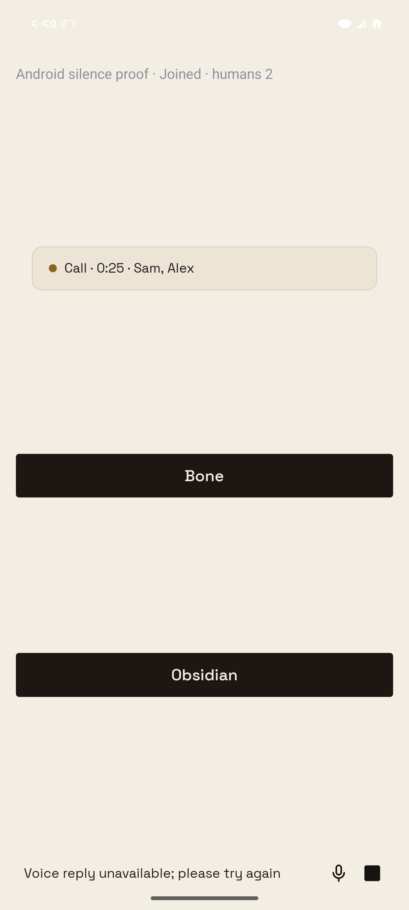

# CALL-ERROR-1: call recovery and provider deadlines

The original runtime removed a caller after an injected database connection error
in membership access. The same Android call path passes with the fix: transient
access and heartbeat failures retain both callers, and an uncertain dispatch
commit creates exactly one command. A failed error notification stays contained.
The server PID and durable call ID remain unchanged throughout the failures.

The proof uses an isolated API 36 Android emulator, a locally built release/Hermes
fixture, LiveKit v1.9.12 and a disposable PGlite Workspace. It renders the production
`useVoiceCall`, `VoiceCallCard` and `VoiceBar`, and uses native WebRTC. Native inbound
RTP packet counts and decoded audio energy verify subsequent replies and the later
command report. The first human is Android; the second is a Node RTC client.

STT final text and provider SSE/PCM responses are controlled stand-ins. No live
OpenRouter or Cloudflare request is made: a controlled fetch can withhold headers
or audio deterministically, ignore abort, or return a known PCM tone. This proves
the real adapters' deadlines and the built client's recoverable error and media
path; it does not measure live provider quality, speech recognition, or a physical
phone's speaker latency. Real agent execution is represented by a provenance-bound
completed command and report, without a deadline on its work.

## Results

- [Original behavior](baseline.json): membership-query failure wrongly removes a
  caller. The regression also fails against the original runtime in Vitest.
- [Fixed behavior](fixed.json): access, heartbeat, dispatch, error-notification,
  brain and TTS failures retain the same call and both callers. Each is followed
  by another reply received on Android. The dispatch is attempted twice with the
  same source ID, but commits one command.
- Brain recovered in 8.011 seconds; TTS in 5.016 seconds.
- Median first-audio publication over five normal turns was 23.5 ms
  before and 22.6 ms after. This is a controlled-provider RTC
  comparison, not a live-provider performance benchmark. Raw samples and native
  media statistics are recorded in those JSON files.
- Expiring the lease closes the original worker before replacing it. The call is
  never ended, both callers remain joined, and the replacement delivers audio.
- Automated tests additionally exercise the 20-second brain and 30-second phrase
  totals, a stream stalled after headers, late headers, cleanup failures, and
  exhausted lease retries followed by expiry.




## Repeating the proof

Build a disposable Android release fixture using
`apps/mobile/scripts/call-error-android-proof.tsx` as the generated Gradle
`react.entryFile`, with `EXPO_PUBLIC_BUZZY_MONOLITH_URL=http://10.0.2.2:18097`.
In the **generated, ignored** Android manifest, enable cleartext for loopback and
disable `expo.modules.updates.ENABLED` so a downloaded production update cannot
replace the fixture. Build only x86_64 with two Gradle workers and a 4 GiB heap.
Install it on a Beeline-leased API 36 emulator and grant microphone access.
No production source/configuration is changed for these fixture settings.

Start a separate LiveKit server on TCP 17890 (signalling), TCP 17891 and UDP 17892,
with development-only `devkey`/`secret`. Then run:

```sh
SILENCE_PROOF_ANDROID_FIRST=1 node --import tsx scripts/prove-voice-call-errors.ts
python3 scripts/prove-voice-call-errors.py --device emulator-PORT --mode fixed
```

For the before run, materialize the original runtime and provider source from
base `0ac88fc72894b02882e5d0017f4e776c9c5e6857` as the temporary server modules
`.call-error-baseline.ts` and `.call-error-baseline-providers.ts`. Run the same
server with `CALL_ERROR_BASELINE=1` and the driver with `--mode baseline`. Remove
those temporary modules afterward. Each run starts a new disposable database;
never point this harness at production.

The fixture control routes bind only to loopback. The driver presses the real
Join control at the fixed API 36 layout position, exercises the failure routes,
and saves observations, screenshots and latency samples. [Build provenance](build.json)
binds the APK and tested server files by SHA-256.
