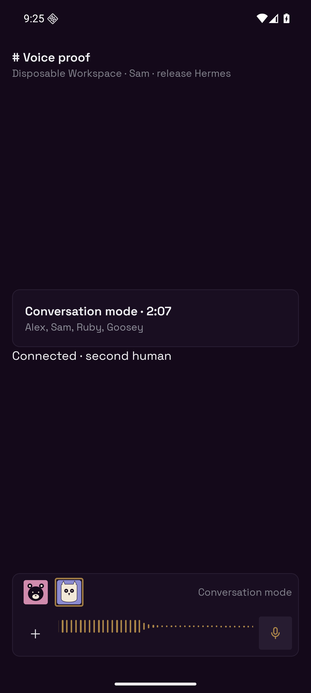

# Multiparty Conversation mode proof

Captured on 2026-10-14 with a task-owned API 36 Android emulator and an
`assembleRelease` Hermes APK. The native fixture mounts the actual call card,
`useVoiceCall`, `ConversationComposer`, `VoiceBar` and native RTC transport.
Its second human presses Join on the ongoing call; the call card remains,
both agents appear in the bar, and the microphone is published.

The server uses a disposable in-memory Workspace with two human identities
and two agent identities, local LiveKit v1.9.12, and real Cloudflare Flux,
OpenRouter Luna and Aura 2. The first human publishes synthesized speech as
actual RTC microphone media. No production Workspace or installed helper is
used. Fixture authentication and its observation endpoint are local only.

The acceptance run verified:

- Ruby was explicitly named and produced one two-sentence reply.
- The next utterance addressed Goosey at its end. Flux transcribed the name
  as its current handle `goose`; the response switched to Goosey immediately.
- Every sentence of both replies was synthesized, exactly matching the full
  generated text. The first human received 742 voiced audio frames; the
  release emulator also observed received agent audio.
- With both humans still in the call, “How are you doing today?” produced
  no agent generation or synthesis, despite the previous Goosey target.
- Repeated joins and concurrent runtime recovery retained one live reply
  stream. The maximum concurrent brain calls was one, and the transcript
  contained exactly the two expected replies.

[Machine-readable results](result.json) record replies, synthesis and received
media. [Build provenance](build.json) records the APK checksum and Hermes header.

Regression tests additionally cover case-insensitive handles and display names,
partial spoken aiming, avatar taps, one-human follow-up, late duplicate final
STT events, duplicate microphone subscriptions, stale runtime leases, full
non-streamed replies, confident speech versus noise/echo, and reports being
claimed once before playback. The concurrent-claim regression originally
connected four runtimes; the fixed version connects one.

Raw SDK logs and scoped session credentials remain ignored. This proves the
source components and real providers/RTC on a release emulator; it does not
measure physical-device speaker latency or reproduce arbitrary background noise.
