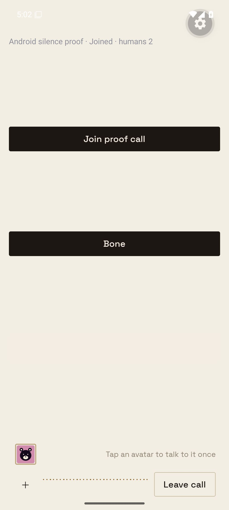
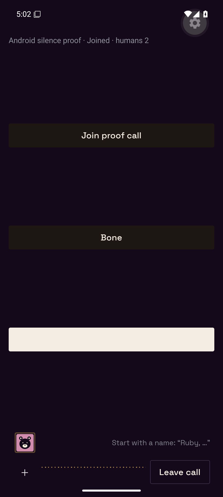

# Multi-human silence proof

Reproduction **multi-human-silence-1**, Android API 36, 17 October 2026.
The native debug APK runs the production `useVoiceCall`, `VoiceBar`, Android
background service and 20-second native deadline. Both humans connect through
LiveKit v1.9.12 to a disposable Pglite Workspace using the real VoiceService and
VoiceRoomRuntime. No production call, installed helper or release is changed.

The closest controlled stand-in injects final text and a deterministic brain
and tone synthesizer. It exercises real RTC audio publication, native microphone
capture, idle/state/resume, database membership and rendered controls. Live Flux,
Luna and Aura are not part of this proof; physical-device speaker latency and
recognition accuracy are not measured. The local proof HTTP adapter calls the
same service methods without production sign-in.

## Reproduced

The first old-code service regression returned `ended` rather than `ready` for
a listener while two people were present. The Android comparison then ran the
original hook, service and runtime from commit `4049229b638616cb9a330cd66c4bc0799f2f6447`.

Two humans joined. Alex's unnamed final text arrived every five seconds while
Sam listened on Android. Sam's native deadline called idle and removed Sam;
after 60 seconds the database held one human and subsequent unnamed speech
produced Ruby replies. [Old result](old.json) records the two-to-one membership
transition, idle/leave requests and the reply count changing from one to nine.

## Demonstrated

- [Fixed result](fixed.json): after 60 seconds both humans still have null
  `left_at` and `parked_at`; unnamed speech yields `unaddressed` without another
  agent reply. Injecting Sam's confirmed stop phrase retains both humans.
- [Old-client result](old-client.json): the original Android hook reaches its
  native deadline on the fixed server, follows idle/state/resume and republishes
  an unmuted microphone with received PCM frames. The server explicitly acknowledges idle playback during resume so the original hook unmutes. It can briefly mute every
  20 seconds until updated, but it neither leaves nor stays permanently muted.
- [Solo result](solo.json): after Alex leaves, the updated Android listener
  receives the one-human count, rearms its native deadline and leaves after
  silence. Pending-order parking also passes the existing service regressions.
- Existing transport-loss coverage still retains a missing participant at
  115 seconds and removes it at 120 seconds. No grace interval was changed.
- Both native themes show a separate labeled Leave call button. Solo retains
  the existing End Conversation mode accessible control.




## Routing investigation

Read-only production inspection confirmed the recorded 20:36:44 Emberus route.
The persisted messages and participant rows do not retain tap, partial-STT or
continuation provenance, so the exact trigger cannot be reconstructed from them.
The runtime does contain a reproducible bypass: before the first audible frame,
a later unnamed final can inherit the pending turn's agent even with two humans.
The regression uses the reported unnamed phrase during that window; it now gets
`unaddressed`, with no source revision or new brain request. Name matching,
one-turn tap behavior and report playback are unchanged.

## Timing

[Five warm samples](timing.json) measure injected final text to first voiced
audio publication through actual local RTC. Median before: **13.25 ms**;
after: **12.28 ms**. These deterministic-provider samples check the local path,
not live provider or phone speaker latency. The turn path adds no network call,
timer or buffering stage; the additional reads are in idle and stop handling.

## Repeat

The fixture entry is `apps/mobile/scripts/multi-human-silence-native-proof.tsx`;
the disposable service is `scripts/prove-multi-human-silence.ts` and assertions
are `scripts/prove-multi-human-silence.py`.

Start a dedicated LiveKit dev server with ports 17890 (HTTP), 17891 (TCP RTC)
and 17892 (UDP RTC), using local-only `devkey`/`secret`. Advertise a host address
reachable by both the emulator and Node clients. The captured run used
172.17.0.1. Start the service with:

```sh
node --import tsx scripts/prove-multi-human-silence.ts
```

For the native fixture, temporarily make the mobile entry import
`./sources/unistyles` before `./scripts/multi-human-silence-native-proof`.
Use Metro aliases for the fixture only: `@/auth/monolith-session` forwards
`fetch`, `@/sync/transport/live-connection` provides inert register/connected
subscriptions, and `./client-error-report` provides error formatting with an
inert reporter. Keep the native voice transport, RTC and timer modules real.
Set `EXPO_PUBLIC_BUZZY_MONOLITH_URL=http://10.0.2.2:18097` for Metro on port 18098.
Build using Expo prebuild and Gradle assembleDebug for x86_64 with two workers
and a 4 GiB Gradle heap. Install only on a task-owned emulator, grant microphone
permission, open the development client and press Join proof call.

```sh
python3 scripts/prove-multi-human-silence.py --phase fixed --output /tmp/fixed.json
```

For the old comparison, extract the three source files from the commit above
into sibling `.silence-proof-old-service.ts`, `.silence-proof-old-runtime.ts`
and `.silence-proof-old-hook.ts` files. Point the old service import at the old
runtime, point the fixture at the old hook, and run the server with
`SILENCE_PROOF_OLD=1`. Use `--phase old`. Run the old hook against the fixed
server with `--phase compat`; use the updated hook and `--phase solo` to verify
rearming. Start a fresh disposable service for each phase. Restore the mobile
entry/config and delete the extracted sources after the proof.
