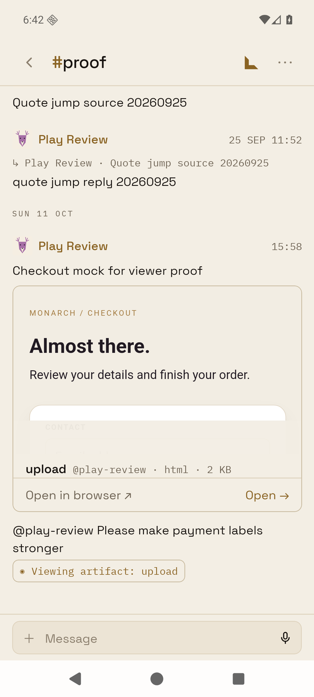
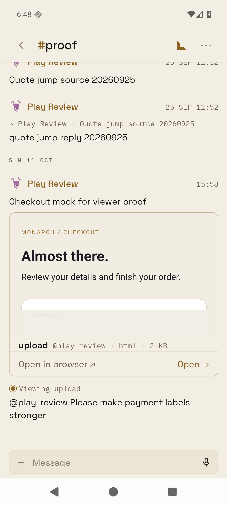
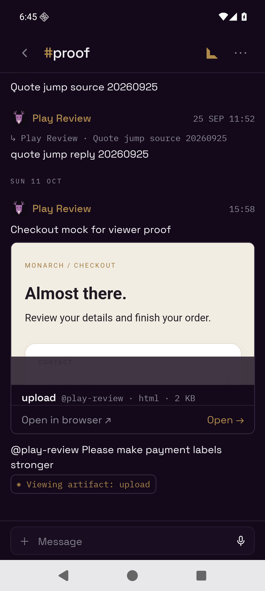
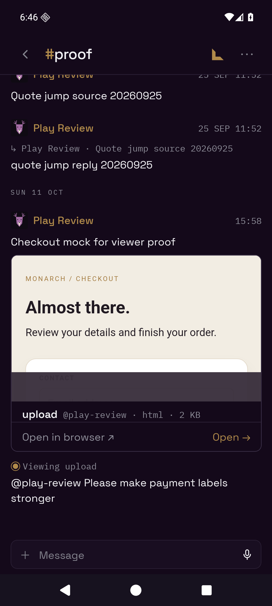
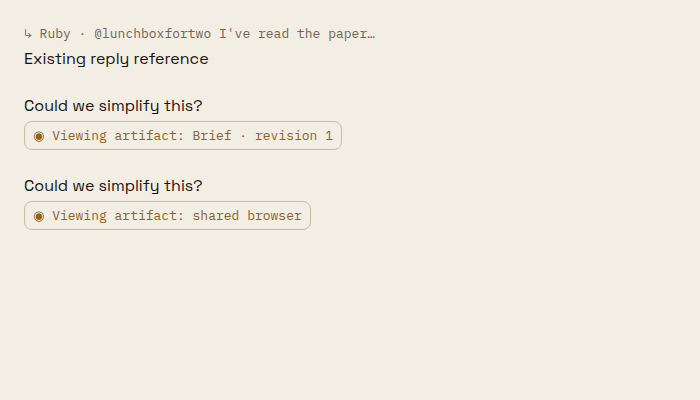
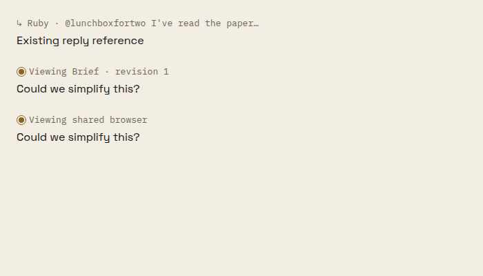
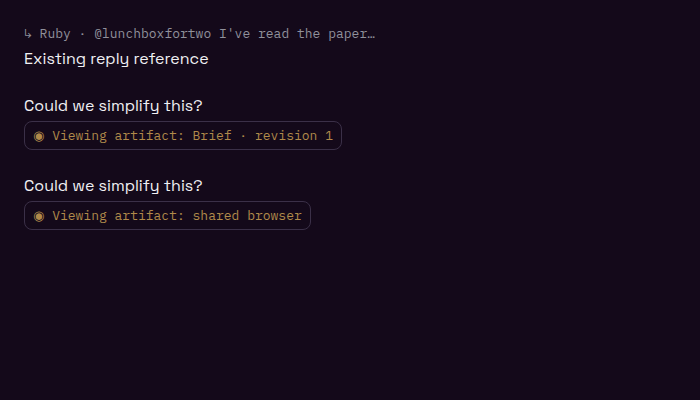
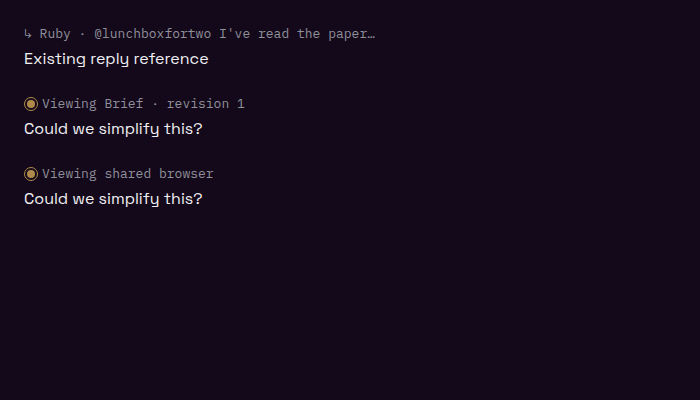

# Viewer context reference

Messages sent from the artifact/browser composer now show a plain provenance line above the message, using the same component, type, color and spacing as swipe-to-reply references. The gold ring is the exact component used by the floating composer. Its row centers the ring and text vertically. The saved context envelope remains unchanged.

## Visual evidence

Android captures use the release APK (`assembleRelease`, x86_64) on the task's read-only emulator at port 5566, signed in through the review deep link. The `#proof` Room already contained a viewer send with an HTML attachment; no new Room message was needed.

| Theme | Before | After |
| --- | --- | --- |
| Light |  |  |
| Dark |  |  |

`android-opened-artifact.png` records tapping the new reference to reopen the artifact.

Web frames use the real `TranscriptReference` and theme/font assets in an isolated headless Chrome fixture. The before fixture reproduces the previous chip style; these are component previews, not authenticated Room screenshots.

| Theme | Before | After |
| --- | --- | --- |
| Light |  |  |
| Dark |  |  |

Reproduce web frames from `apps/mobile`: `npx tsx scripts/render-viewer-reference-proof.ts`. The harness checks equal ring/text vertical centers and click dispatch.

## Validation

159 targeted renderer, viewer-context, artifact, browser and design-lint tests passed. Mobile typecheck and the Android release build passed.

Artifact references reopen their attached artifact. Browser references resolve the latest same-title browser session in the Room snapshot at or before the send timestamp and obtain fresh access through the existing phone operation. A historical browser reference whose session card is outside the loaded Room snapshot remains plain text until that card is available; the renderer test guards against selecting a session created after the send.
