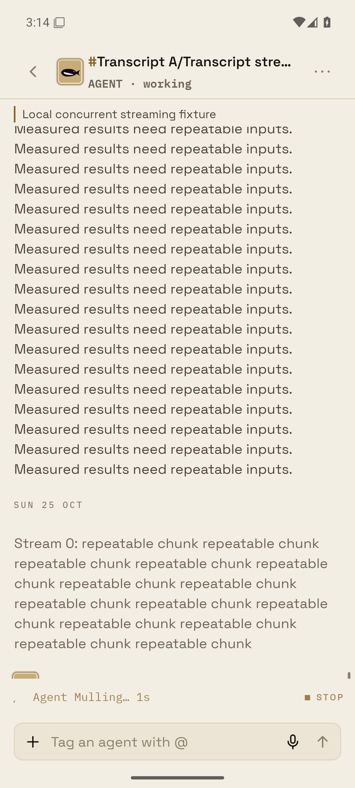
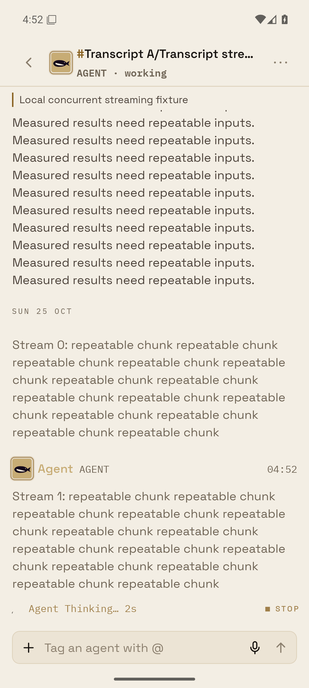

# Concurrent Android streams: STREAM-CLIP-1

Verdict: a product scroll-follow bug. Main’s release APK clipped a stream in the fresh mounted trials (one of ten) and in the complete harness blocks (two of three). The retained original process failure is the missing-stream OCR assertion; its stack does not show an independent process crash.

The diagnostic trace records both rows growing, then a native offset of (84.19 dp) after the content-size callback had already sent the tail scroll, with no drag. That offset cleared the logical tail pin, so later draft commits stopped following. The failed view remained clipped after the stimulus paused for (2.5 seconds). The trace, failed and delayed screenshots, and diagnostic source patch are retained separately from acceptance timing.

Android now preserves the pre-commit follow decision through content layout and a native tail acknowledgement. A transient zero during native autoscroll momentum cannot settle the request; the resting event completes or corrects it. A reader drag, explicit history destination, cancellation or Room reset clears both waits. The existing FlatList, native anchor configuration and row memoization remain in use.

## Demonstrated

The final release APK passed the navigated two-agent flow (ten of ten), then every strict complete harness block (three of three), with no path failures. All sends settled on the fixture server. Older history loaded in every block.

Typing committed no transcript rows across the full suite (twenty-one keypresses). Each full-suite incoming sample committed its new row (one); concurrent streams retained the baseline median row count (twenty-three).

The separate row audit passed visible edits, server reactions, a real reaction toggle, keyboard positioning and history anchoring. Its incoming sample also committed Fixture 0971 at the history-window edge; probes count mounts as well as updates. Edits and server reactions each committed the affected row (one). The toggle committed only that same row (three times). Typing committed no rows. The older reading anchor stayed at the same point before and after incoming content (541, 1192).





## Timing comparison

Per-trial frame p95 medians below use the unchanged full harness. Each interaction has repeated trials (three); typing has keypress trials (twenty-one). JS rAF intervals and native HWUI percentiles are different measurements. Ranges, p50, worst gaps and missed JS frame opportunities are in [summary.json](summary.json); raw samples are in the archive.

| Scenario | JS p95 ms, baseline / fixed | HWUI p95 ms, baseline / fixed | Row commits, baseline / fixed |
| --- | ---: | ---: | ---: |
| Key press | (18.00 / 17.79) | (16 / 16) | (0 / 0) |
| Scroll | (22.56 / 21.85) | (44 / 36) | (0 / 0) |
| Fling | (41.37 / 27.72) | (34 / 32) | (31 / 31) |
| History paging | (22.92 / 22.63) | (36 / 36) | (149 / 191) |
| Incoming | (17.67 / 17.83) | (32 / 16) | (1 / 1) |
| Room switches | (70.61 / 70.25) | (101 / 101) | (1142 / 1142) |
| Concurrent replies | (38.22 / 31.07) | (32 / 21) | (23 / 23) |
| Settled send | (32.61 / 32.97) | (30 / 30) | (6 / 6) |

History counts include rows mounted as pages load. The baseline’s first typing block also loaded unread history; its raw stalls are retained and are not attributed to this fix. Small incoming/send median differences remain inside the observed repeat spread.

The separate real-tap transition proof uses unprofiled transitions per APK (six). Values are median with observed min–max, in milliseconds. Settling includes the harness’s quiet confirmation window; native paint ends at frame commit.

| Transition measure | Baseline | Fixed |
| --- | ---: | ---: |
| Native first paint | (226.00; 220.00–267.00) | (231.50; 223.00–241.00) |
| Time to settled | (981.64; 958.03–1028.47) | (970.26; 957.63–1005.61) |
| JS busy CPU | (490.02; 486.90–570.41) | (487.09; 476.75–536.20) |
| Worst JS gap per transition | (173.29; 160.19–214.57) | (170.62; 165.93–175.17) |

The frame and transition captures establish no material pacing regression in this fixture. Measurements describe the same shared-host Android emulator with SwiftShader, API (36), Hermes/Fabric and React Compiler off. Network shaping used RTT (100 ms), jitter (zero) and bandwidth (10 Mbps). This corner’s builds and tests were stopped during capture.

## Validation and provenance

- Root typecheck passed.
- Focused mobile tests passed (106); harness measurement tests passed (eight).
- The new regression fails with the earlier acknowledgement behavior and passes with the fix. Both logs are retained.
- Every capture verified the installed APK hash. The final APK contains no diagnostic trace probes.

Baseline APK SHA-256: `5de7208326400f245aeed334312ad7d32a212df933ba3fc6e42840e3b0b9c36c`.

Fixed APK SHA-256: `54b8383eab79dfa46d3d600c046bddef5963bd8cbfa076f77d6b6afaad804670`.

The fixed build records checkout `aaac9f7f7782774e692120e73469830b50bcae3c` plus tracked source diff `78be9d7eb7d304917cdd31a445f8bf3ba61052a27411d555306fe4059f958260`. Both source patches and the build log are archived. Baseline is main `174162f49ad69f441f03b6a92d6b4e7da312eacd`. The transcript surface and controller matched that baseline before this fix.

[evidence.zip](evidence.zip) contains all final warm-trial screenshots/OCR, full captures, native transition/CPU records, row-audit screenshots, original failure evidence, diagnostic trace, validation logs, driver snapshots and a file hash manifest. APK binaries remain local. [SHA256SUMS](SHA256SUMS) covers the delivered files.

## Repeat

Follow the [fixture/build setup](../../README.md), select the owned emulator and explicit matching APK, then sign into the disposable fixture. Set `LATENCY_RIG_DATABASE_URL`, `LATENCY_RIG_DEVICE`, `TRANSCRIPT_APK` and the isolated capture channel. Reset only fixture traffic and clear only the fixture app before each APK arm.

```sh
node scripts/transcript-speed/reset.mjs
TRANSCRIPT_STREAM_COLD=0 node scripts/transcript-speed/capture-concurrent-streams.mjs <warm-output>
TRANSCRIPT_REPEAT_COUNT=3 TRANSCRIPT_EXPERIMENT_KEEP_FAILURES=0 node scripts/transcript-speed/capture-android.mjs <full-output>
node scripts/transcript-speed/capture-room-transitions.mjs <transition-output>
node scripts/transcript-speed/capture-row-updates.mjs <row-output>
```

The dedicated stream driver fails after any missing-stream trial. The full driver uses its strict default assertion. Midpoint screenshots demonstrate the recorded reproduction; continuous visibility between snapshots is unmeasured.
